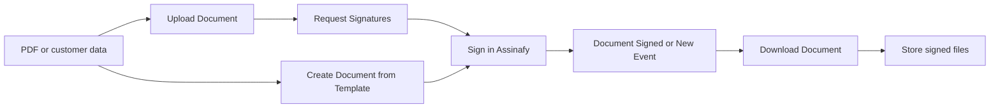

# Assinafy for Activepieces

[Português (Brasil)](README.pt-BR.md)

Send documents for legally valid electronic signature with [Assinafy](https://www.assinafy.com.br) and act on the result in [Activepieces](https://www.activepieces.com) flows: upload a PDF, invite signers by email or WhatsApp, wait for the signatures and store the signed PDF wherever you need it.

- Package: `@assinafy/piece-assinafy`
- Requires Activepieces 0.88.2 or later running Node.js 24 LTS
- Assinafy accepts only HTTPS with TLS 1.2 or higher, which the Node.js runtime of Activepieces uses by default
- API reference: <https://api.assinafy.com.br/v1/docs>

## Install

As a platform admin of your Activepieces instance:

1. Open **Platform Admin → Setup → Pieces** and click **Install Piece**.
2. Choose **NPM Registry**, enter the package name `@assinafy/piece-assinafy` and the version, for example `0.2.1`.
3. The piece appears as **Assinafy** in the flow builder.

To update, install the new version the same way.

## Connect your Assinafy account

The piece offers two connection types. Use **API Key** to automate your own workspace, and **Assinafy Account (OAuth)** when other people connect their own workspaces.

### API Key

1. Sign in to [Assinafy](https://app.assinafy.com.br) (or the [sandbox](https://app-sandbox.assinafy.com.br) for testing).
2. Open **My Account → API** and create an API key. A dedicated Assinafy user for automations keeps its access easy to control.
3. In Activepieces, create an Assinafy connection of type **API Key**:
   - **API Key**: the key you created.
   - **Environment**: **Production**, or **Sandbox** for keys created in the sandbox.
   - **Workspace ID**: only needed when your user belongs to more than one workspace. Copy it from **My Account → Workspaces**.

The connection is checked against `GET /v1/accounts` when you save it, and it is labelled with the workspace name.

### Assinafy Account (OAuth)

An owner of the Assinafy workspace registers an OAuth application once, under **Settings → OAuth applications**:

| Field | Value |
|---|---|
| Redirect URI | The redirect URL shown by Activepieces in the connection dialog, for example `https://automations.example.com/redirect` |
| Type | Confidential |
| Permissions | `documents:read`, `documents:write`, `templates:read`, `templates:write`, `account:read`, `webhooks:write`, `offline_access` |

Enter the application's Client ID and Client Secret in Activepieces, then sign in and choose the workspace to connect. Save the connection within a minute of approving: the approval code expires after 60 seconds. Each OAuth connection works with exactly one workspace. OAuth always uses the production environment; use an API key for the sandbox.

Activepieces renews the access automatically when flows use the connection, and each renewal keeps the connection valid for another 30 days. A connection only expires after 30 days without use, for example when its flows are off or run less than once every 30 days; reconnect it then. Deleting the connection in Activepieces does not revoke its access in Assinafy; revoke it under **Connected apps** in your Assinafy profile.

## The document flow

Every Assinafy flow moves a document through the same stages. The piece has one action per stage:



1. **Upload**: [Upload Document](#upload-document) sends a PDF to `POST /v1/accounts/{accountId}/documents`, or [Create Document from Template](#create-document-from-template) generates the document from a ready template and sends it in one step.
2. **Send**: [Request Signatures](#request-signatures) creates the signature request with `POST /v1/documents/{documentId}/assignments`. Assinafy then emails or messages each signer.
3. **Track**: [Get Document](#get-document) and [Find Documents](#find-documents) read the status and signing progress; [Update Signing Deadline](#update-signing-deadline) and [Resend Signature Request](#resend-signature-request) nudge an in-flight request.
4. **Sign**: signers open the signing link and sign in Assinafy, with a one-time code by email or WhatsApp, biometric identity verification, or an ICP-Brasil A1/A3 certificate.
5. **Collect**: [Download Document](#download-document) saves the signed PDF with its signature certificate so later steps can store it.

Triggers fire at the moments that matter: **Document Signed** when the signed PDF is ready, or **New Event (Instant)** for each signing event as it happens.

### Flow recipe: send a PDF for signature

1. Any trigger that provides a file (a form, an email attachment, a CRM record).
2. **Upload Document** with that file.
3. **Request Signatures** on the uploaded document, with each signer's name and email or WhatsApp number.
4. Save the returned `document_id`/`assignment_id` on the source record to track it.

Create and enable a second collection flow before sending documents:

1. **Document Signed** as its trigger, or **New Event (Instant)** selecting `document_ready`.
2. **Download Document**: map `id` from Document Signed, or `document_id` from New Event, into **Document**; choose *Signed PDF*.
3. Upload the returned `file` to Google Drive, SharePoint or S3 and update the source record using the saved document ID. Select *PAdES* as an additional download when preserving ICP-Brasil certificate signatures is required.

For a single running flow, use a Delay/Get Document loop until `certificated`, with a timeout and a branch for `rejected_by_signer`, `rejected_by_user`, `expired` or `failed`. Signing can take days; separate sending and collection flows avoid keeping a run open.

### Flow recipe: generate a contract from a template

1. Any trigger with the customer's details.
2. **Create Document from Template**: pick the template, fill the signer for each role and the template fields. The document is created and sent in one step.

### Flow recipe: react the instant something happens

1. **New Event (Instant)** with the events you care about, for example *Document signed by all signers* and *Signer declined the document*.
2. A Router step that branches on `event`: store the signed PDF on `document_ready`, notify the owner on `signer_rejected_document`.

### Flow recipe: request biometric verification

1. Enable a **New Event (Instant)** flow for `signer_identity_review_required`, `signer_identity_review_rejected` and `document_ready`, with a Router that notifies the owner about reviews and downloads only ready documents.
2. Upload the PDF and use **Request Signatures** with `verification: "biometric_email"` or `"biometric_whatsapp"`; provide the matching contact and a CPF for a new signer. Use **Update Signer** first if an existing signer needs a CPF. Template roles accept the same verification values.
3. Save the document and assignment IDs on the source record. The signer completes the ID photos and liveness check in Assinafy.
4. If review is required, the owner decides it in Assinafy. Approved documents proceed to certification after all signatures; rejected documents follow the cancellation branch. Store the signed PDF from the collection flow.

## Actions

Each action below lists the Assinafy API endpoint it calls and an example of the data it returns. All outputs use flat fields, except `signers`, which lists one record per signer so flows can loop over them. See [Output fields](#output-fields) for the full field list.

### Upload Document

Uploads a PDF (up to 25 MB) so you can request signatures on it. Each call creates a new document, so retries create duplicates.

- Endpoint: `POST /v1/accounts/{accountId}/documents` (multipart file upload)
- Inputs: **File** (required), **Document Name** (optional, defaults to the file name)

Returns the document, for example:

```json
{
  "id": "615601fab04c0a3147bb1246",
  "name": "Service agreement.pdf",
  "status": "uploading",
  "status_label": "Uploading",
  "is_closed": false,
  "account_id": "d199996981dbd199996981db",
  "page_count": null,
  "available_files": null,
  "created_at": "2026-09-01T12:00:00.000Z",
  "updated_at": "2026-09-01T12:00:00.000Z"
}
```

### Request Signatures

Sends a document to one or more people to sign. Existing signers are matched by email (or by name and WhatsApp number); missing signers are created, which requires a full name. Assinafy notifies signers right away, or by signing order when steps are set. Each call creates a new signature request, so do not retry blindly.

- Endpoint: `POST /v1/documents/{documentId}/assignments`
- Inputs: **Document** (required), **Signers** (required), **Message**, **Deadline**, **Send Copy To**

Example request body sent to Assinafy:

```json
{
  "method": "virtual",
  "signers": [
    {
      "id": "62d6ee35c7741ca4006b9e11",
      "verification_method": "Email",
      "notification_methods": ["Email"],
      "step": 1
    }
  ],
  "message": "Please sign the service agreement by Friday.",
  "expires_at": "2026-12-31T21:00:00.000Z",
  "copy_receivers": ["62d6ee35c7741ca4006b9e12"]
}
```

Returns the signature request:

```json
{
  "document_id": "615601fab04c0a3147bb1246",
  "message": "Please sign the service agreement by Friday.",
  "sender_email": "sender@example.com",
  "assignment_id": "615606ef81d199996981dbce",
  "signature_method": "virtual",
  "expires_at": "2026-12-31T21:00:00.000Z",
  "signer_count": 1,
  "signed_count": 0,
  "signer_emails": "maria@example.com",
  "signers": [
    {
      "id": "62d6ee35c7741ca4006b9e11",
      "full_name": "Maria Silva",
      "email": "maria@example.com",
      "whatsapp_phone_number": null,
      "step": 1,
      "verification_method": "Email",
      "notification_method": "Email",
      "identity_verification_status": null,
      "signed": false,
      "signing_url": "https://api.assinafy.com.br/v1/sign/615601fab04c0a3147bb1246?email=maria@example.com"
    }
  ]
}
```

A fresh upload can still be receiving its file; the step waits up to 30 seconds for processing before sending. Copy recipients may not be available on every plan: when Assinafy does not keep a requested copy recipient, the step fails after sending and reports the signature request ID, so you do not invite the signers twice.

### Create Document from Template

Creates a document from a ready template and sends it for signature in one step. Each template signer role gets its own email, WhatsApp number, full name, CPF/CNPJ, verification and signing order inputs; editor roles are not signers, and their fields appear under **Template Fields** to pre-fill the document. Each call creates and sends a new document, so do not retry blindly.

- Endpoint: `POST /v1/accounts/{accountId}/templates/{templateId}/documents`
- Inputs: **Template** (required), **Signers** (one entry per template role, required), **Template Fields**, **Document Name**, **Message**, **Deadline**, **Tags**

Returns the document (same shape as **Upload Document**) with `template_id` set.

### Get Document

Gets one document with its status, signers and signing progress.

- Endpoint: `GET /v1/documents/{documentId}`
- Inputs: **Document** (required)

Returns the complete [document output](#document-payload).

### Find Documents

Finds documents by name, signer or status, most recently updated first. Returns an empty list when nothing matches.

- Endpoint: `GET /v1/accounts/{accountId}/documents` with `search`, `status` and `sort=-updated_at`
- Inputs: **Search**, **Status**, **Maximum Results** (1–100, default 25)

Returns a list of documents.

### Download Document

Downloads a file of a document as a file for later steps. The signed PDF exists only after every signer has signed; while certification is still running the step waits up to a minute.

- Endpoint: `GET /v1/documents/{documentId}/download/{artifactName}`
- Inputs: **Document** (required), **File** (required: signed PDF, original, certificate page, ZIP bundle or PAdES), **File Name**

Returns:

```json
{
  "file": "https://files.example.com/service-agreement-certificated.pdf",
  "file_name": "service-agreement-certificated.pdf",
  "file_type": "certificated",
  "size_bytes": 48213,
  "document_id": "615601fab04c0a3147bb1246",
  "document_name": "Service agreement.pdf",
  "document_status": "certificated"
}
```

### Resend Signature Request

Sends the signing invitation to one signer again, using the signer's original channel. WhatsApp resends consume credits. Each call sends another notification.

- Endpoint: `PUT /v1/documents/{documentId}/assignments/{assignmentId}/signers/{signerId}/resend`
- Inputs: **Document** (required), **Signer** (required, the signers of the chosen document)

Returns `{ "sent": true, "document_id": "…", "assignment_id": "…", "signer_id": "…" }`.

### Update Signing Deadline

Sets a new deadline on the signature request of a document. The new deadline must be at least one hour in the future. Setting the same deadline again is safe.

- Endpoint: `PUT /v1/documents/{documentId}/assignments/{assignmentId}/reset-expiration`
- Inputs: **Document** (required), **New Deadline** (required)

Returns the signature request shape shown in [Request Signatures](#request-signatures).

### Delete Document

Permanently deletes a document. Only documents that are ready to send, waiting for signatures, declined, cancelled, expired or failed can be deleted; signed documents are kept. This cannot be undone, and a retry fails because the document is gone.

- Endpoint: `DELETE /v1/documents/{documentId}`
- Inputs: **Document** (required)

Returns `{ "deleted": true, "document_id": "…" }`.

### Find Signers

Finds the signers saved in the workspace by partial name or email. Returns an empty list when nothing matches.

- Endpoint: `GET /v1/accounts/{accountId}/signers` with `search`
- Inputs: **Search** (required), **Maximum Results** (1–100, default 25)

Returns a list of signers:

```json
[
  {
    "id": "62d6ee35c7741ca4006b9e11",
    "full_name": "Maria Silva",
    "email": "maria@example.com",
    "whatsapp_phone_number": null,
    "has_accepted_terms": false
  }
]
```

### Create Signer

Saves a new signer in the workspace. **Request Signatures** creates missing signers on its own, so use this only to register people ahead of time. It fails when a signer with the same email already exists.

- Endpoint: `POST /v1/accounts/{accountId}/signers`
- Inputs: **Full Name** (required), **Email**, **WhatsApp Number**, **CPF or CNPJ**

Returns the signer shape shown in [Find Signers](#find-signers).

### Update Signer

Changes the name, contact details or CPF/CNPJ of a saved signer; only the fields you fill in change. Email and WhatsApp cannot change while the signer has verified that channel on a document still being signed, and changing an unverified channel invalidates invitations already sent.

- Endpoint: `PUT /v1/accounts/{accountId}/signers/{signerId}`
- Inputs: **Signer** (required), **Full Name**, **Email**, **WhatsApp Number**, **CPF or CNPJ**

Returns the signer shape shown in [Find Signers](#find-signers).

### Custom API Call

Calls any endpoint of the Assinafy API with the connection's credentials, for endpoints the piece does not cover. The credentials are sent only to the connection's Assinafy address, so **Follow redirects** must stay off. Workspace-scoped paths such as `/accounts/{accountId}/signers` need your workspace ID, which the piece resolves for you on its own actions.

Every document, signer and template input in the actions above is a dropdown, searchable except for the signer in **Resend Signature Request**, which lists the signers of the chosen document. You can also map an ID from a previous step.

## Triggers

| Trigger | When it fires | Delivery |
|---|---|---|
| Document Signed | Every signer has signed and the signed PDF is ready, for signings completed after the flow was turned on | Checked every few minutes. Any number of flows can use it. |
| New Event (Instant) | The selected Assinafy events happen: document signed by all, signer signed, signer declined, document cancelled, and more | Instant, through a webhook endpoint registered for the flow |

**New Event (Instant)** registers its own webhook endpoint (`/v1/accounts/{accountId}/webhooks/endpoints`):

- An Assinafy workspace has 1 webhook endpoint, or up to 3 on paid plans. Each active flow using this trigger takes one endpoint, named `Activepieces`; add a Router step to handle several event types in one flow.
- When every endpoint is taken, the flow does not start unless **Replace Existing Webhook** is turned on. That setting reuses the workspace's oldest endpoint, which then stops delivering to its current system.
- Turning the flow off deletes its endpoint, which frees the slot. An endpoint that no longer points at the flow is left alone.
- **Delivery Notice Email** receives Assinafy's notices about failed deliveries. When it is empty, the address of the flow's endpoint or of the oldest endpoint is used.
- On API key and Assinafy Account connections the endpoint is created with signing on. Every delivery then carries a [Standard Webhooks](https://www.standardwebhooks.com) signature (`webhook-id`, `webhook-timestamp`, `webhook-signature`), and the flow ignores deliveries whose HMAC-SHA256 signature does not match the endpoint secret or whose timestamp is more than five minutes off. The flow obtains the secret when it is turned on; after rotating the secret in Assinafy, turn the flow off and on again.
- OAuth applications receive the signing secret once in the endpoint creation response. The flow stores it with the endpoint ID and reuses it on republish. An unsigned OAuth endpoint, or one whose stored secret is missing, is deleted and recreated when the flow is enabled. API key connections can also read the secret from the secret endpoint.
- Each flow also registers its address with a random token, and requests without it are ignored. The token stays the same when the flow is republished or turned off and on, so deliveries already on their way still count.
- For document events, the flow receives the current state of the document, read from the API when the event arrives. If it cannot be read (for example after the document was deleted), the copy sent with the event is used.
- Assinafy retries a failed delivery once with the same `webhook-id`, which the flow uses as the deduplication key.
- Where the workspace supports only a single webhook address (the endpoints path answers `404`), the flow uses `/v1/accounts/{accountId}/webhooks/subscriptions` instead. It then refuses to take over an address that delivers to another system unless **Replace Existing Webhook** is on, and turning the flow off deactivates the address while it still points at the flow.

The document is signed as soon as the last signer signs, but the signed PDF is available only after certification finishes. **Document Signed** fires after certification; **Download Document** also waits up to a minute while certification is still running.

**Document Signed** fires once per document whose signing completed after the flow was turned on. It reads each new signed document's activity log (`GET /v1/documents/{documentId}/activities`) for the completion time, so documents signed earlier and edited later (for example tagged) do not fire it. Each check looks back ten minutes to tolerate clock differences. After downtime it catches up on the backlog over several checks, with a bounded ledger to suppress recent duplicates.

## Signers

**Request Signatures** and **Create Document from Template** take contact details, not Assinafy signer IDs:

- A signer is matched by email, or by name and WhatsApp number when there is no email, so give the full name of a signer who has only a WhatsApp number. WhatsApp numbers match regardless of formatting, and a number without the country code matches the saved international number.
- If nobody matches, a signer is created, which requires a full name.
- A missing WhatsApp number is added to an existing signer. A WhatsApp number that differs from the saved one stops the step with an error instead of using the saved value.
- A CPF/CNPJ is saved only when the signer is created; the step never changes the CPF/CNPJ of an existing signer. Use **Update Signer** for that.
- Change saved details with **Update Signer**; changing a channel invalidates invitations that were already sent.
- Every signer and copy recipient row is checked, and every one of them is looked up, before any signer is created or changed: a contact for the chosen channel, a valid CPF or CNPJ (including its check digits; CNPJs may be alphanumeric), no repeated email or WhatsApp number, no person reached twice through different details, and the signing order rules below.

## Verification and costs

Signers prove their identity while signing with one of four verification methods and six invitation combinations; A1 and A3 ICP-Brasil certificates both use the digital certificate method:

| Verification | Invitation | Cost per signer |
|---|---|---|
| Email code (default) | Email | Free |
| WhatsApp code | WhatsApp | 0.45 credit (paid plans) |
| ICP-Brasil digital certificate (A1 or A3) | Email | 0.5 credit |
| ICP-Brasil digital certificate (A1 or A3) | WhatsApp | 0.95 credit (0.5 for the certificate signature plus 0.45 for the WhatsApp invitation) |
| Biometric identity verification | Email | Per-signer verification fee; requires the ID Document + Face Match feature |
| Biometric identity verification | WhatsApp | Verification fee plus 0.45 credit for the invitation (paid plans) |

When **Verification** is empty, it is email, or WhatsApp when the signer has only a WhatsApp number. Digital certificate signing needs the Digital Certificate feature on the Assinafy plan, the signer's CPF or CNPJ saved in Assinafy (given in the step when the signer is new, or set with **Update Signer**), the signer alone in their signing order step and assignment `method: "virtual"`. A `DigitalCertificate` signer is not supported in a `collect` assignment with placed fields. Every signature request also uses one document from the plan, or one credit when the allowance is used up.

Biometric verification (`IdDocumentFaceMatchBasic`) checks a government ID photo, a photo of the signer holding it and liveness. It requires a valid CPF saved on the signer and the ID Document + Face Match feature. Both sending actions check the required saved or new CPF/CNPJ before creating or updating any signer. CNPJ is accepted for certificates, but not biometrics. Use the API cost estimate for the current biometric fee.

A biometric signer can sign while their verification is `InReview`; the document then waits at `pending_identity_review` until the workspace owner approves it in Assinafy. Route `signer_identity_review_required` to an owner notification, and wait for `document_ready` or **Document Signed** before downloading. Rejection cancels the document and emits `signer_identity_review_rejected` followed by `user_rejected_document`. Each entry in `signers` exposes `identity_verification_status` (`Pending`, `InReview`, `Approved`, `Declined`, `Expired`, `Abandoned`, or `null`).

## Signing order

Leave **Signing Order** empty for everyone to sign at the same time. To sign in sequence, set it on every signer: all signers with `1` are invited first, `2` after all of them sign, and so on. The numbers must start at 1 without gaps, and a digital certificate signer cannot share a number with anyone.

## Request and response reference

These examples use fictional IDs and `example.com` addresses. Replace them with values from your workspace. Deadlines are examples and must still be at least one hour after execution. **Inputs** are the piece's property keys for flow mapping; **HTTP** is the request sent to Assinafy. Optional empty values are omitted. The reusable payloads below include every output field exposed by the piece; the API can return additional fields, and missing optional fields map to `null` (signer lists map to `[]`). This integration exposes twelve dedicated actions, Custom API Call and two triggers; other API operations are available through Custom API Call.

### HTTP conventions

| Connection | Base URL | Header |
|---|---|---|
| API key, production | `https://api.assinafy.com.br/v1` | `X-Api-Key: <api-key>` |
| API key, sandbox | `https://sandbox.assinafy.com.br/v1` | `X-Api-Key: <sandbox-api-key>` |
| OAuth, production | `https://api.assinafy.com.br/v1` | `Authorization: Bearer <access-token>` |

JSON writes use `Content-Type: application/json`. GET and DELETE requests have no body unless explicitly shown. Dedicated actions unwrap the API's `{status, message, data}` envelope and flatten entities. Custom API Call returns the framework's raw HTTP result. File downloads return binary bytes, not an envelope. API errors include the HTTP status, API message and available error details; transport errors on writes report that the server may already have received the request. A failed multi-request action can leave a created signer or sent request: inspect the document before repeating a send.

### Document payload

A successful document read uses this envelope. `assignment` is populated when available; a new upload or asynchronously generated template document can return it as `null`. A signed document uses `status: "certificated"`, `is_closed: true`, completed signers and additional artifacts. `pades` is available for ICP-Brasil signatures. Pages, tags and signers are arrays, so the example shows one representative entry in each.

```json
{
  "status": 200,
  "message": "",
  "data": {
    "resource": "document",
    "id": "615601fab04c0a3147bb1246",
    "account_id": "d199996981dbd199996981db",
    "template_id": null,
    "name": "Service agreement.pdf",
    "status": "pending_signature",
    "artifacts": {
      "original": "https://api.assinafy.com.br/v1/documents/615601fab04c0a3147bb1246/download/original"
    },
    "is_closed": false,
    "signing_url": "https://api.assinafy.com.br/v1/sign/615601fab04c0a3147bb1246",
    "decline_reason": null,
    "declined_by": null,
    "tags": [
      {
        "id": "615610fab04c0a3147bb1246",
        "name": "Contracts"
      }
    ],
    "assignment": {
      "resource": "assignment",
      "id": "615606ef81d199996981dbce",
      "sender_email": "sender@example.com",
      "method": "virtual",
      "expires_at": "2030-12-31T21:00:00Z",
      "message": "Please sign the service agreement.",
      "signers": [
        {
          "id": "62d6ee35c7741ca4006b9e11",
          "full_name": "Maria Silva",
          "email": "maria@example.com",
          "whatsapp_phone_number": null,
          "has_accepted_terms": false,
          "step": 1,
          "verification_method": "Email",
          "notification_methods": [
            "Email"
          ],
          "completed": false
        }
      ],
      "copy_receivers": [],
      "items": [],
      "summary": {
        "signer_count": 1,
        "completed_count": 0
      },
      "signing_urls": [
        {
          "signer_id": "62d6ee35c7741ca4006b9e11",
          "url": "https://api.assinafy.com.br/v1/sign/615601fab04c0a3147bb1246?email=maria@example.com"
        }
      ]
    },
    "pages": [
      {
        "id": "615611fab04c0a3147bb1246",
        "number": 1,
        "width": 1240,
        "height": 1755,
        "download_url": "https://api.assinafy.com.br/v1/documents/615601fab04c0a3147bb1246/pages/1/download",
        "fields": []
      }
    ],
    "created_at": "2026-09-01T12:00:00Z",
    "updated_at": "2026-09-01T12:01:00Z"
  }
}
```

The complete **document output** used by Upload Document, Create Document from Template, Get Document, Find Documents and Document Signed is:

```json
{
  "id": "615601fab04c0a3147bb1246",
  "name": "Service agreement.pdf",
  "status": "pending_signature",
  "status_label": "Waiting for signatures",
  "is_closed": false,
  "account_id": "d199996981dbd199996981db",
  "template_id": null,
  "page_count": 1,
  "tags": "Contracts",
  "available_files": "original",
  "signing_url": "https://api.assinafy.com.br/v1/sign/615601fab04c0a3147bb1246",
  "decline_reason": null,
  "declined_by_name": null,
  "declined_by_email": null,
  "created_at": "2026-09-01T12:00:00Z",
  "updated_at": "2026-09-01T12:01:00Z",
  "assignment_id": "615606ef81d199996981dbce",
  "signature_method": "virtual",
  "expires_at": "2030-12-31T21:00:00Z",
  "signer_count": 1,
  "signed_count": 0,
  "signer_emails": "maria@example.com",
  "signers": [
    {
      "id": "62d6ee35c7741ca4006b9e11",
      "full_name": "Maria Silva",
      "email": "maria@example.com",
      "whatsapp_phone_number": null,
      "step": 1,
      "verification_method": "Email",
      "notification_method": "Email",
      "identity_verification_status": null,
      "signed": false,
      "signing_url": "https://api.assinafy.com.br/v1/sign/615601fab04c0a3147bb1246?email=maria@example.com"
    }
  ]
}
```

An upload initially returns `status: "uploading"`, `page_count: null` and null assignment summary fields until processing creates them. Template generation is asynchronous: use the returned `id` with Get Document to read the assignment and progress. Find Documents returns an array of these complete outputs, or `[]`.

### Assignment payload

Request Signatures and Update Signing Deadline return an envelope whose `data` is the full `assignment` object in the document example above. Their complete **signature request output** is:

```json
{
  "document_id": "615601fab04c0a3147bb1246",
  "message": "Please sign the service agreement.",
  "sender_email": "sender@example.com",
  "assignment_id": "615606ef81d199996981dbce",
  "signature_method": "virtual",
  "expires_at": "2030-12-31T21:00:00Z",
  "signer_count": 1,
  "signed_count": 0,
  "signer_emails": "maria@example.com",
  "signers": [
    {
      "id": "62d6ee35c7741ca4006b9e11",
      "full_name": "Maria Silva",
      "email": "maria@example.com",
      "whatsapp_phone_number": null,
      "step": 1,
      "verification_method": "Email",
      "notification_method": "Email",
      "identity_verification_status": null,
      "signed": false,
      "signing_url": "https://api.assinafy.com.br/v1/sign/615601fab04c0a3147bb1246?email=maria@example.com"
    }
  ]
}
```

### Signer payload

Create Signer and Update Signer return:

```json
{
  "status": 200,
  "message": "",
  "data": {
    "resource": "signer",
    "id": "62d6ee35c7741ca4006b9e11",
    "full_name": "Maria Silva",
    "email": "maria@example.com",
    "whatsapp_phone_number": null,
    "government_id": "39053344705",
    "has_accepted_terms": false
  }
}
```

Their complete **signer output**, and each entry returned by Find Signers, is:

```json
{
  "id": "62d6ee35c7741ca4006b9e11",
  "full_name": "Maria Silva",
  "email": "maria@example.com",
  "whatsapp_phone_number": null,
  "has_accepted_terms": false
}
```

The signer output leaves out the CPF/CNPJ. Find Signers returns an array of signer outputs, or `[]`.

### Action inputs and HTTP requests

#### Upload Document payload

Inputs:

```json
{
  "file": "https://files.example.com/service-agreement.pdf",
  "name": "Service agreement.pdf"
}
```

Activepieces resolves the file URL, previous-step file or base64 data URL to bytes. HTTP: `POST /accounts/{accountId}/documents`, multipart field **file**, filename `Service agreement.pdf`, content type `application/pdf`, PDF bytes as the part body. The piece supplies the boundary; do not encode the PDF as JSON. The name input controls the uploaded filename. Assinafy validates the PDF and its 2,000-page limit; the piece checks the 25 MB limit before uploading. Response: the [document payload](#document-payload), initially uploading.

#### Request Signatures payload

Inputs:

```json
{
  "document": "615601fab04c0a3147bb1246",
  "signers": [
    {
      "full_name": "Maria Silva",
      "email": "maria@example.com",
      "verification": "email",
      "step": 1
    }
  ],
  "message": "Please sign the service agreement.",
  "expires_at": "2030-12-31T21:00:00Z",
  "copy_receivers": [
    {
      "full_name": "Legal Team",
      "email": "legal@example.com"
    }
  ]
}
```

Each signer row also accepts `whatsapp` and `government_id`. Verification property values are `email`, `whatsapp`, `certificate_email`, `certificate_whatsapp`, `biometric_email`, `biometric_whatsapp`. The piece first reads the document, looks up every signer/copy recipient using the workspace signers list, and creates or updates missing details with the signer requests below. HTTP: `POST /documents/{documentId}/assignments`:

```json
{
  "method": "virtual",
  "signers": [
    {
      "id": "62d6ee35c7741ca4006b9e11",
      "verification_method": "Email",
      "notification_methods": [
        "Email"
      ],
      "step": 1
    }
  ],
  "message": "Please sign the service agreement.",
  "expires_at": "2030-12-31T21:00:00.000Z",
  "copy_receivers": [
    "62d6ee35c7741ca4006b9e12"
  ]
}
```

Exactly one notification method is sent per signer. The other combinations are `Whatsapp`/`["Whatsapp"]`, `DigitalCertificate`/`["Email"]`, `DigitalCertificate`/`["Whatsapp"]`, `IdDocumentFaceMatchBasic`/`["Email"]` and `IdDocumentFaceMatchBasic`/`["Whatsapp"]`. A1 and A3 use the same `DigitalCertificate` API method, which requires assignment `method: "virtual"`; any other method is rejected with code `DIGITAL_CERTIFICATE_REQUIRES_VIRTUAL`. Omit `step` on every signer for parallel signing. Response: the [assignment payload](#assignment-payload).

#### Create Document from Template payload

The piece reads `GET /accounts/{accountId}/templates?page=1&per-page=50` and further pages to locate the selected template (up to 500 templates). Roles provide `id`, `name`, `assignment_type`; page fields provide `field_id`, `role_id`, `label`. Non-editor roles appear under Signers; fields belonging to Editor roles appear under Template Fields. Template status must be ready (capitalization is accepted). A template with placed fields creates a `collect` assignment, so choosing `DigitalCertificate` for any signer is rejected before signer changes with code `DIGITAL_CERTIFICATE_REQUIRES_VIRTUAL`; use a fieldless template or another verification method.

Inputs for one signer role and one editor field:

```json
{
  "template": "615607fab04c0a3147bb1246",
  "signers": {
    "email_615608fab04c0a3147bb1246": "maria@example.com",
    "name_615608fab04c0a3147bb1246": "Maria Silva",
    "verification_615608fab04c0a3147bb1246": "email",
    "step_615608fab04c0a3147bb1246": "1"
  },
  "editor_fields": {
    "field_615609fab04c0a3147bb1246": "Example Company"
  },
  "document_name": "Service agreement.pdf",
  "message": "Please sign the service agreement.",
  "expires_at": "2030-12-31T21:00:00Z",
  "tags": [
    "Contracts"
  ]
}
```

Each role also accepts `whatsapp_{roleId}` and `cpf_{roleId}`. CopyReceiver roles receive copies without signing; their verification and signing-order inputs are ignored and they do not occupy a signing step. The piece resolves workspace signers before generating the document. HTTP: `POST /accounts/{accountId}/templates/{templateId}/documents`:

```json
{
  "signers": [
    {
      "role_id": "615608fab04c0a3147bb1246",
      "id": "62d6ee35c7741ca4006b9e11",
      "verification_method": "Email",
      "notification_methods": [
        "Email"
      ],
      "step": 1
    }
  ],
  "editor_fields": [
    {
      "field_id": "615609fab04c0a3147bb1246",
      "value": "Example Company"
    }
  ],
  "name": "Service agreement.pdf",
  "message": "Please sign the service agreement.",
  "expires_at": "2030-12-31T21:00:00.000Z",
  "tags": [
    "Contracts"
  ]
}
```

Response: the [document payload](#document-payload) with `template_id` set; assignment details can appear after generation finishes. The API applies template defaults for omitted optional fields; tags merge with the template's default document tags.

#### Get Document payload

Inputs:

```json
{
  "document": "615601fab04c0a3147bb1246"
}
```

HTTP: `GET /documents/{documentId}`. Response: the [document payload](#document-payload).

#### Find Documents payload

Inputs:

```json
{
  "search": "Service agreement",
  "status": "pending_signature",
  "limit": 25
}
```

HTTP: `GET /accounts/{accountId}/documents?search=Service%20agreement&status=pending_signature&sort=-updated_at&page=1&per-page=50`. Empty search/status are omitted. Limit must be an integer from 1 to 100; default 25. Further pages are fetched until the limit or end is reached. API response: `{ "status": 200, "message": "", "data": [document] }`, where each document is the complete [document payload's](#document-payload) `data` object. Piece output: `[documentOutput]`, with the complete field set shown there; no matches return `[]`. Valid status codes are those in the status table below.

#### Download Document payload

Inputs:

```json
{
  "document": "615601fab04c0a3147bb1246",
  "file_type": "certificated",
  "file_name": "service-agreement-signed.pdf"
}
```

HTTP first reads `GET /documents/{documentId}`, then `GET /documents/{documentId}/download/certificated`. The download response is PDF bytes or a redirect to an HTTPS storage URL, followed with credentials removed when the origin changes. All accepted `file_type` values: `certificated`, `original`, `certificate-page`, `bundle`, `pades`. `bundle` returns ZIP bytes; the others return PDF bytes. Complete output:

```json
{
  "file": "https://files.example.com/service-agreement-signed.pdf",
  "file_name": "service-agreement-signed.pdf",
  "file_type": "certificated",
  "size_bytes": 48213,
  "document_id": "615601fab04c0a3147bb1246",
  "document_name": "Service agreement.pdf",
  "document_status": "certificated"
}
```

`file` is the reference returned by Activepieces file storage, usable by subsequent file actions. Empty `file_name` derives a name from the document and selected artifact.

#### Resend Signature Request payload

Inputs:

```json
{
  "document": "615601fab04c0a3147bb1246",
  "signer": "62d6ee35c7741ca4006b9e11"
}
```

The piece reads the document to resolve its assignment; Assinafy validates the signer and resend eligibility. HTTP: `PUT /documents/{documentId}/assignments/{assignmentId}/signers/{signerId}/resend`, no body. API response:

```json
{
  "status": 200,
  "message": "",
  "data": {
    "is_sent": true,
    "document_id": "615601fab04c0a3147bb1246",
    "signer_id": "62d6ee35c7741ca4006b9e11"
  }
}
```

Complete output:

```json
{
  "sent": true,
  "document_id": "615601fab04c0a3147bb1246",
  "assignment_id": "615606ef81d199996981dbce",
  "signer_id": "62d6ee35c7741ca4006b9e11"
}
```

#### Update Signing Deadline payload

Inputs:

```json
{
  "document": "615601fab04c0a3147bb1246",
  "expires_at": "2030-12-31T21:00:00Z"
}
```

The piece reads the document to resolve its assignment. HTTP: `PUT /documents/{documentId}/assignments/{assignmentId}/reset-expiration`:

```json
{
  "expires_at": "2030-12-31T21:00:00.000Z"
}
```

Response: the [assignment payload](#assignment-payload) with the updated expiry.

#### Delete Document payload

Inputs:

```json
{
  "document": "615601fab04c0a3147bb1246"
}
```

Assinafy validates the document lifecycle status. HTTP: `DELETE /documents/{documentId}`, no body. API response:

```json
{
  "status": 200,
  "message": "",
  "data": []
}
```

Complete output:

```json
{
  "deleted": true,
  "document_id": "615601fab04c0a3147bb1246"
}
```

#### Find Signers payload

Inputs:

```json
{
  "search": "maria@example.com",
  "limit": 25
}
```

HTTP: `GET /accounts/{accountId}/signers?search=maria%40example.com&page=1&per-page=50`. Search is required; limit is an integer from 1 to 100 (default 25). Response: `{ "status": 200, "message": "", "data": [signer] }`, using the complete [signer payload](#signer-payload). Complete piece output:

```json
[
  {
    "id": "62d6ee35c7741ca4006b9e11",
    "full_name": "Maria Silva",
    "email": "maria@example.com",
    "whatsapp_phone_number": null,
    "has_accepted_terms": false
  }
]
```

#### Create Signer payload

Inputs:

```json
{
  "full_name": "Maria Silva",
  "email": "maria@example.com",
  "whatsapp": "+5548999990000",
  "government_id": "390.533.447-05"
}
```

HTTP: `POST /accounts/{accountId}/signers`:

```json
{
  "full_name": "Maria Silva",
  "email": "maria@example.com",
  "whatsapp_phone_number": "+5548999990000",
  "government_id": "390.533.447-05"
}
```

Empty inputs are left out. The call returns the [signer payload](#signer-payload), and the piece returns the signer output.

#### Update Signer payload

Inputs:

```json
{
  "signer": "62d6ee35c7741ca4006b9e11",
  "full_name": "Maria Silva",
  "email": "maria@example.com",
  "whatsapp": "+5548999990000",
  "government_id": "390.533.447-05"
}
```

HTTP: `PUT /accounts/{accountId}/signers/{signerId}`:

```json
{
  "full_name": "Maria Silva",
  "email": "maria@example.com",
  "whatsapp_phone_number": "+5548999990000",
  "government_id": "390.533.447-05"
}
```

Only nonempty inputs are sent; at least one change is required. Response: the [signer payload](#signer-payload).

#### Custom API Call payload

In the builder choose Method `GET`, URL `/accounts`, empty headers/query/body and **Follow redirects** `false`. HTTP: `GET /v1/accounts` with the selected connection's auth header. Example complete framework output:

```json
{
  "status": 200,
  "headers": {
    "content-type": "application/json"
  },
  "body": {
    "status": 200,
    "message": "",
    "data": [
      {
        "resource": "account",
        "id": "d199996981dbd199996981db",
        "name": "Example Workspace"
      }
    ]
  }
}
```

For an additional operation, choose Method `POST`, URL `/documents/{documentId}/assignments/estimate-cost`, JSON body:

```json
{
  "method": "virtual",
  "signers": [
    {
      "verification_method": "DigitalCertificate",
      "notification_methods": [
        "Email"
      ]
    }
  ]
}
```

Response body (example balances):

```json
{
  "status": 200,
  "message": "",
  "data": {
    "documents": 1,
    "credits": 0.5,
    "needs_extra_document": false,
    "extra_document_cost": 0,
    "total_credits": 0.5,
    "breakdown": [
      {
        "code": "SignatureDigitalCertificate",
        "quantity": 1,
        "unit_cost": 0.5,
        "cost": 0.5,
        "name": "Digital certificate signature"
      }
    ],
    "document_balance": 10,
    "credit_balance": 20,
    "has_sufficient_resources": true,
    "blocking_reason": null,
    "message": null
  }
}
```

The endpoint creates no assignment. A workspace plan can reject unavailable verification/notification features with HTTP 403. For both this endpoint and `POST /documents/{documentId}/assignments`, Custom API Call rejects a `DigitalCertificate` signer unless `method` is exactly `virtual`, with code `DIGITAL_CERTIFICATE_REQUIRES_VIRTUAL`. Custom API Call leaves the envelope inside `body`; its response headers and bodies vary by endpoint.

### Trigger requests and payloads

**Document Signed** has no inputs. It reads workspace documents with `status=certificated&sort=-updated_at&page=1&per-page=50` and document activities. Activity response example:

```json
{
  "status": 200,
  "message": "",
  "data": [
    {
      "id": 4821,
      "event": "document_ready",
      "created_at": "2026-09-01T14:32:10Z"
    }
  ]
}
```

Each emitted item is the complete [document output](#document-payload), with signed status and counters. A polling invocation returns an array of items internally; Activepieces starts one flow run per item.

**New Event (Instant)** inputs:

```json
{
  "events": [
    "document_ready",
    "signer_rejected_document"
  ],
  "notification_email": "ops@example.com",
  "replace_existing": false
}
```

Enable lists `GET /accounts/{accountId}/webhooks/endpoints`. When no endpoint points at the flow, it sends `POST /accounts/{accountId}/webhooks/endpoints`; when one does, it sends `PUT /accounts/{accountId}/webhooks/endpoints/{endpointId}` with the same body:

```json
{
  "name": "Activepieces",
  "url": "https://automations.example.com/webhooks/example-flow?assinafy_token=<random-token>",
  "email": "ops@example.com",
  "events": [
    "document_ready",
    "signer_rejected_document"
  ],
  "is_active": true,
  "signing_enabled": true
}
```

`signing_enabled` is `true` for both connection types. A `403` on create means every endpoint is taken; with **Replace Existing Webhook** on, API key connections update the oldest endpoint, while OAuth connections delete it and create a new signed endpoint to obtain a new secret. The API returns the endpoint (creation also returns `secret`):

```json
{
  "status": 200,
  "message": "",
  "data": {
    "id": "65f1c2a9b3e4d5f60718293a4b5c6d7e",
    "name": "Activepieces",
    "url": "https://automations.example.com/webhooks/example-flow?assinafy_token=<random-token>",
    "email": "ops@example.com",
    "events": [
      "document_ready",
      "signer_rejected_document"
    ],
    "is_active": true,
    "signing_enabled": true,
    "created_at": "2026-10-01T12:00:00Z",
    "updated_at": "2026-10-01T12:00:00Z",
    "secret": "whsec_MfKQ9r8GKYqrTwjUPD8ILPZIo2LaLaSw"
  }
}
```

The create response includes `secret` alongside the endpoint fields above. The flow keeps it and the endpoint ID in the flow store. An API key connection reads `GET /accounts/{accountId}/webhooks/endpoints/{endpointId}/secret` when the response has no secret; OAuth never calls this restricted endpoint. Its response is:

```json
{
  "status": 200,
  "message": "",
  "data": {
    "secret": "whsec_MfKQ9r8GKYqrTwjUPD8ILPZIo2LaLaSw"
  }
}
```

Disable lists the endpoints and sends `DELETE /accounts/{accountId}/webhooks/endpoints/{endpointId}` for the endpoint that points at the flow (`data` is `[]`).

When the endpoints path answers `404`, enable reads `GET /accounts/{accountId}/webhooks/subscriptions`, sends `PUT` to the same path and reads it back to verify the registration:

```json
{
  "events": [
    "document_ready",
    "signer_rejected_document"
  ],
  "is_active": true,
  "url": "https://automations.example.com/webhooks/example-flow?assinafy_token=<random-token>",
  "email": "ops@example.com"
}
```

Disable then reads the subscription and sends `PUT /accounts/{accountId}/webhooks/inactivate` only if it still points at the flow.

Example webhook POST delivered by Assinafy. The token stays in the request query, and a signed endpoint adds these headers:

```http
webhook-id: 9f86d081884c7d659a2feaa0c55ad015
webhook-timestamp: 1788273130
webhook-signature: v1,<base64 HMAC-SHA256 of "{webhook-id}.{webhook-timestamp}.{raw body}">
```

```json
{
  "id": 4821,
  "event": "document_ready",
  "message": "The document was signed by all signers.",
  "created_at": 1788273130,
  "account_id": "d199996981dbd199996981db",
  "subject": {
    "type": "Account",
    "id": "d199996981dbd199996981db",
    "name": "Example Workspace"
  },
  "object": {
    "type": "Document",
    "id": "615601fab04c0a3147bb1246",
    "name": "Service agreement.pdf"
  },
  "payload": {
    "signer_email": "maria@example.com"
  }
}
```

The output starts with these fields, plus **every** field from the complete [document output](#document-payload) prefixed with `document_` (for example `document_id`, `document_status`, `document_signers`):

```json
{
  "event_id": 4821,
  "event": "document_ready",
  "message": "The document was signed by all signers.",
  "occurred_at": "2026-09-01T14:32:10.000Z",
  "account_id": "d199996981dbd199996981db",
  "actor_type": "Account",
  "actor_id": "d199996981dbd199996981db",
  "actor_name": "Example Workspace",
  "actor_email": null,
  "object_type": "Document",
  "object_id": "615601fab04c0a3147bb1246",
  "object_name": "Service agreement.pdf",
  "detail_signer_email": "maria@example.com"
}
```

Payload keys become `detail_{key}`; nested values are JSON strings. For non-document events the document-prefixed scalars are null and `document_signers` is `[]`. Activepieces also receives a reserved deduplication key: the `webhook-id` header, or `event_id` when the header is missing. Accepted event codes:

`document_ready`, `signer_signed_document`, `signer_rejected_document`, `user_rejected_document`, `signer_viewed_document`, `signature_requested`, `assignment_created`, `document_uploaded`, `document_metadata_ready`, `document_prepared`, `document_processing_failed`, `signer_created`, `signer_email_verified`, `signer_whatsapp_verified`, `signer_data_confirmed`, `signer_identity_verified`, `signer_identity_verification_failed`, `signer_identity_review_required`, `signer_identity_review_approved`, `signer_identity_review_rejected`, `template_created`, `template_processed`, `template_processing_failed`.

### OAuth protocol payloads

Activepieces handles this protocol; flow authors use the connection dialog. Discovery: [authorization server](https://auth.assinafy.com.br/.well-known/oauth-authorization-server) and [protected resource](https://api.assinafy.com.br/.well-known/oauth-protected-resource).

Authorization: `GET https://auth.assinafy.com.br/oauth/authorize` with these URL-encoded parameters:

```text
response_type=code
client_id=<client-id>
redirect_uri=https://automations.example.com/redirect
scope=documents:read documents:write templates:read templates:write account:read webhooks:write offline_access
state=<random-state>
code_challenge=<base64url-sha256-of-verifier>
code_challenge_method=S256
resource=https://api.assinafy.com.br
```

Validate state and the issuer on the callback. Exchange: `POST https://api.assinafy.com.br/v1/oauth/token`, `Content-Type: application/x-www-form-urlencoded`, body fields:

```text
grant_type=authorization_code
client_id=<client-id>
client_secret=<client-secret>
code=<authorization-code>
redirect_uri=https://automations.example.com/redirect
code_verifier=<original-verifier>
resource=https://api.assinafy.com.br
```

Tokens use plain JSON, **without** the standard API envelope:

```json
{
  "access_token": "<access-token>",
  "token_type": "Bearer",
  "expires_in": 3600,
  "refresh_token": "<refresh-token>",
  "scope": "documents:read documents:write templates:read templates:write account:read webhooks:write offline_access"
}
```

Refresh: POST to the same token endpoint with URL-encoded `grant_type=refresh_token`, `client_id`, `client_secret`, `refresh_token` and `resource=https://api.assinafy.com.br`. Response has the same token fields with new access/refresh tokens. Store the replacement refresh token atomically and serialize refreshes: reusing a consumed token revokes its token family. Access tokens last one hour; refresh validity slides by 30 days after renewal.

Revoke: `POST https://api.assinafy.com.br/v1/oauth/revoke` with URL-encoded `client_id`, `client_secret`, `token=<refresh-token>`, `token_type_hint=refresh_token`. Success is HTTP 200 with an empty response; revoked bearer access returns HTTP 401. The connection dialog and platform own token exchange/refresh; the piece's HTTP client receives an already-managed access token.

### Document status codes

| Status | Meaning |
|---|---|
| `uploading` | File transfer in progress |
| `uploaded` | File received |
| `metadata_processing` | Pages and metadata processing |
| `metadata_ready` | Ready for a signature request |
| `pending_signature` | Waiting for signers |
| `pending_identity_review` | All signers signed; identity review must be approved before certification |
| `certificating` | All signed; preparing final files |
| `certificated` | Signed files available |
| `rejected_by_signer` | Declined by a signer |
| `rejected_by_user` | Cancelled by a workspace user |
| `expired` | Signing deadline passed |
| `failed` | Processing failed |

## Output fields

Document and signature request outputs:

| Field | Description |
|---|---|
| `id`, `name` | Document ID and name |
| `account_id`, `signing_url` | The workspace, and the link to the signing page |
| `status`, `status_label` | Status code (for example `pending_signature`, `certificated`) and its readable label |
| `is_closed` | Whether the signing process is finished |
| `available_files` | Files that can be downloaded, for example `original, certificated, certificate-page, bundle` |
| `signer_count`, `signed_count`, `signer_emails` | Signing progress |
| `signers` | One entry per signer: name, email, WhatsApp, step, verification, identity verification status, whether they signed, signing link |
| `assignment_id`, `signature_method`, `expires_at` | The signature request and its deadline |
| `message`, `sender_email`, `document_id` | Signature request only: invitation text, sender, document |
| `decline_reason`, `declined_by_name`, `declined_by_email` | Filled when a signer declines |
| `tags`, `page_count`, `template_id`, `created_at`, `updated_at` | Other document details |

Signer outputs: `id`, `full_name`, `email`, `whatsapp_phone_number`, `has_accepted_terms`.

**New Event (Instant)** outputs:

| Field | Description |
|---|---|
| `event_id`, `event`, `message`, `occurred_at` | The event, for example `document_ready`, and when it happened |
| `account_id` | The workspace |
| `actor_type`, `actor_id`, `actor_name`, `actor_email` | Who caused it: a user, signer or the workspace |
| `object_type`, `object_id`, `object_name` | What it happened to: a document, signer or template |
| `detail_*` | Event details, for example `detail_signer_email` or `detail_error_message` |
| `document_*` | Every document field above, prefixed with `document_`; empty for events about signers or templates |

## Troubleshooting

| Message | What to do |
|---|---|
| `HTTP 401 … check the API key` | The key is wrong, was deleted, or belongs to the other environment. Create a new key or change **Environment**. |
| `This API key can access N workspaces` | Set **Workspace ID** on the connection. |
| `… is not available for this document yet` | The file does not exist yet, for example the signed PDF before everyone signs. |
| `Every webhook endpoint of this Assinafy workspace is already in use` | Delete an endpoint you no longer need under the workspace webhook settings in Assinafy, turn on **Replace Existing Webhook** to reuse the oldest one, or use **Document Signed**. |
| `This Assinafy workspace already sends its webhooks to …` | The workspace has a single webhook address and another system receives its events. Turn on **Replace Existing Webhook** only if that system no longer needs them, or use **Document Signed**. |
| New Event flow stopped receiving events after the signing secret was rotated | Turn the flow off and on again so it reads the new secret. |
| `HTTP 403 … approved permissions` | The item belongs to another workspace or needs a different Assinafy role. On an OAuth connection, a missing permission also causes it: add the permission to the OAuth application and reconnect. Billing, members and credentials are never available to OAuth connections. |
| `HTTP 401` on an OAuth connection that used to work | The access was revoked under **Connected apps** in Assinafy, the OAuth application was deleted or disabled, the app was approved again with different permissions, or the connection went 30 days without use. Reconnect. |
| `… is saved in Assinafy with a different WhatsApp number` | Update the signer with **Update Signer**, or leave WhatsApp Number empty to use the saved number. |
| `… must be the only signer in their signing order step` | Give the digital certificate signer a signing order number of their own. |
| `Assinafy is still receiving the file of this document` | The upload was still in progress after 30 seconds. Run the step again, or add a Delay step after **Upload Document**. |

## Development

Requirements: Node.js 24 LTS and Git.

```sh
npm install              # also downloads the Activepieces libraries
npm run typecheck        # source and tests
npm test                 # unit tests, no network
npm run test:coverage    # with coverage thresholds
npm run build            # bundles the piece into dist/
```

The piece is built against the Activepieces piece framework at the commit in `ACTIVEPIECES_REF`. `npm install` downloads the framework, common and core libraries from that commit into `.activepieces/`, and the build bundles them into a single file. To build against a newer Activepieces, change `ACTIVEPIECES_REF`, run `npm install` and run the tests.

Vitest 4 enforces 95% statements/lines, 90% branches and 100% functions. Framework preparation preserves Node.js TLS certificate verification; a real-client regression check verifies that HTTP calls leave it enabled.

Unit tests mock the HTTP client and block any real network request. One upload test runs the real Activepieces HTTP client against a stubbed `fetch` to check the multipart request on the wire.

### Implementation notes

- Requests made by triggers time out after 15 seconds, well within the time Activepieces gives a trigger run; actions allow 120 seconds.
- When two runs create the same new signer at the same moment, the run that loses reuses the signer the other one created.
- Requests do not follow redirects automatically. A redirect is followed only for reads and downloads and only to an `https://` address, and the credentials are left out when it points outside the Assinafy address, for example to file storage.
- Uploads use `form-data` with a filename, content type and multipart boundary handled by the Activepieces HTTP client.
- The piece requests 50 items per page. The API reference permits up to 100; list reads follow `X-Pagination-Page-Count` and stop at a short or repeated page.
- The API reference documents no single-template endpoint, so the template form and action scan up to 500 templates.
- **Document Signed** keeps its own state and keeps it when a flow is republished: the time it was turned on, the last completed check, the position of an unfinished backlog scan, and a ledger of documents it fired recently.
  - Signed documents are listed newest first, cannot be deleted, and only move down the list as others are signed or edited. A backlog scan therefore resumes after the last document it examined (by update time and ID), and the time checkpoint advances only when the scan has reached documents older than the previous check.
  - A document fires when its completion time (the newest `document_ready` activity, else the newest `signer_signed_document`) is after the trigger was turned on and no more than 24 hours before the start of the check window. A document with neither activity does not fire. The ledger remembers the documents fired in that period so later edits do not fire them again, drops entries that can no longer pass the rule, and holds at most 5,000 entries to stay within the Activepieces store limit.
  - Each check reads at most 10 pages of 50 documents and 40 activity logs, and stops after 30 seconds; the next check continues where it stopped. An error after some documents were examined keeps that progress; an error before any fails the check.
  - Authorization errors (401/403) fail the check without emitting that document. Other unreadable activity logs are tried again on the next two checks. After that it fires with its update time as the completion time, so one broken document cannot stop the trigger.
  - Activepieces saves a polling trigger's progress before it starts the flow runs for the returned items. If starting them fails, those documents are not returned again. This applies to every Activepieces polling trigger; the piece gets no signal to replay them.

### Sandbox tests

`test/live.test.ts` runs against the Assinafy sandbox only and deletes everything it creates:

```sh
ASSINAFY_API_KEY=<sandbox key> npm run test:live
```

| Variable | Effect |
|---|---|
| `ASSINAFY_ACCOUNT_ID` | Workspace to use when the key has several |
| `ASSINAFY_LIVE_SEND=1` | Also sends an uploaded document and a ready one-signer template to `example.com` addresses (uses plan documents) |
| `ASSINAFY_LIVE_REQUIRE_PAID_METHODS=1` | Requires all six cost estimates and enabled assignment checks to succeed; otherwise explicit plan restrictions are checked |
| `ASSINAFY_LIVE_WEBHOOK=1` | Also turns the New Event trigger on and off: a signed webhook endpoint where the workspace supports endpoints, otherwise the single webhook address, which it restores afterwards; checks the endpoint-limit response and skips registration when all slots are occupied, preserving existing destinations |
| `ASSINAFY_LIVE_WEBHOOK_EMAIL` | Delivery notice address for the webhook check (defaults to an `example.com` address) |

The suite checks all six verification/notification cost requests, reads signing activities and downloads the available final PDF/ZIP artifacts from an existing signed document. With sending enabled it also creates assignments for all six combinations, with the tested signer in step 2 behind an unsigned email signer; WhatsApp and identity-verification invitations remain inactive. All created resources are removed, including when a check fails. The template sending check requires a ready template with one signer role and no editor fields. These API checks do not complete an OTP, biometric or A1/A3 signing session; that requires the recipient, identity capture or a compatible certificate.

The sandbox limits bursts of requests with HTTP 429; the suite waits for the time the response names and sends the request again.

### Production OAuth tests

After authorizing a temporary confidential app using the registered HTTPS callback and PKCE, store its token response outside the repository in a file readable only by you:

```sh
ASSINAFY_OAUTH_TOKEN_FILE=/private/tmp/assinafy-token.json npm run test:oauth
```

Alternatively supply `ASSINAFY_OAUTH_ACCESS_TOKEN`. The two tests read the authorized workspace, documents, signer/template dropdowns and trigger samples. Exchange, rotating refresh and revocation use the protocol above; revoke the temporary refresh token after testing. For a local callback, `cloudflared tunnel --url http://127.0.0.1:18763 --protocol http2` supplies an HTTPS URL to register, then stop the callback and tunnel after the check. Keep state, verifier, client secret and tokens outside the repository and printed output.

### Try it in Activepieces

Run `npm run build`, then `npm pack ./dist` to create a `.tgz` file. In Activepieces, open **Setup → Pieces** in the platform admin, click **Install Piece**, choose **Packed Archive (.tgz)** and upload the file.

### Translations

`src/i18n/translation.json` is generated from the piece and `src/i18n/pt.json` holds the Brazilian Portuguese strings. After changing any display name, description or option label:

```sh
npm run translations
```

Then update `pt.json`. The tests fail while either file is out of date.

Activepieces does not translate the connection dialog of a piece with more than one connection type, so the dialog is shown in English.

### Publishing

1. Bump `version` in `package.json` (patch for new actions, optional inputs and fixes; major for removals, new required inputs or changed behavior) and add the release to `CHANGELOG.md`.
2. Run `npm run licenses`. It rewrites `LICENSE` with the license of every package bundled into the published file.
3. Check the package with `npm run build && npm publish ./dist --dry-run`.
4. Commit, push to `main`, and push a `piece-assinafy-vX.Y.Z` tag that matches the version. The **Publish Assinafy piece** workflow typechecks, tests and builds the piece, then publishes it to npm through trusted publishing, together with the READMEs, `LICENSE` and `CHANGELOG.md`.

Never rename an action, trigger or input after release: flows reference them by name.

## License

MIT. The published package also bundles the Activepieces libraries and a few npm packages; `LICENSE` lists each one with its license.
