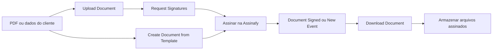

# Assinafy para Activepieces

[English](README.md)

Envie documentos para assinatura eletrônica com validade jurídica pela [Assinafy](https://www.assinafy.com.br) e use o resultado em fluxos do [Activepieces](https://www.activepieces.com): envie um PDF, convide os signatários por e-mail ou WhatsApp, aguarde as assinaturas e guarde o PDF assinado onde precisar.

- Pacote: `@assinafy/piece-assinafy`
- Requer Activepieces 0.88.2 ou superior
- A Assinafy aceita apenas HTTPS com TLS 1.2 ou superior, que o runtime Node.js do Activepieces usa por padrão
- Referência da API: <https://api.assinafy.com.br/v1/docs>

## Instalação

Como administrador da plataforma na sua instância do Activepieces:

1. Abra **Platform Admin → Setup → Pieces** e clique em **Install Piece**.
2. Escolha **NPM Registry**, informe o nome do pacote `@assinafy/piece-assinafy` e a versão, por exemplo `0.1.3`.
3. A peça aparece como **Assinafy** no editor de fluxos.

Para atualizar, instale a nova versão da mesma forma.

## Conectar sua conta Assinafy

A peça oferece dois tipos de conexão. Use **API Key** para automatizar o seu próprio espaço de trabalho e **Assinafy Account (OAuth)** quando outras pessoas conectarem os espaços de trabalho delas.

### API Key

1. Entre na [Assinafy](https://app.assinafy.com.br) (ou no [sandbox](https://app-sandbox.assinafy.com.br) para testes).
2. Abra **Minha Conta → API** e crie uma chave de API. Um usuário da Assinafy dedicado às automações facilita o controle do acesso.
3. No Activepieces, crie uma conexão Assinafy do tipo **API Key**:
   - **API Key**: a chave criada.
   - **Environment**: **Production**, ou **Sandbox** para chaves criadas no sandbox.
   - **Workspace ID**: necessário apenas quando o seu usuário pertence a mais de um espaço de trabalho. Copie de **Minha Conta → Espaços de trabalho**.

A conexão é verificada em `GET /v1/accounts` ao salvar e recebe o nome do espaço de trabalho.

### Assinafy Account (OAuth)

Um proprietário do espaço de trabalho na Assinafy registra uma aplicação OAuth uma única vez, em **Configurações → Aplicações OAuth**:

| Campo | Valor |
|---|---|
| URI de redirecionamento | A URL de redirecionamento exibida pelo Activepieces na janela de conexão, por exemplo `https://automations.example.com/redirect` |
| Tipo | Confidencial |
| Permissões | `documents:read`, `documents:write`, `templates:read`, `templates:write`, `account:read`, `webhooks:write`, `offline_access` |

Informe o Client ID e o Client Secret da aplicação no Activepieces, depois entre na Assinafy e escolha o espaço de trabalho a conectar. Salve a conexão em até um minuto após aprovar: o código de aprovação expira em 60 segundos. Cada conexão OAuth funciona com exatamente um espaço de trabalho. O OAuth sempre usa o ambiente de produção; para o sandbox, use uma chave de API.

O Activepieces renova o acesso automaticamente quando os fluxos usam a conexão, e cada renovação mantém a conexão válida por mais 30 dias. A conexão só expira depois de 30 dias sem uso, por exemplo quando seus fluxos estão desativados ou rodam menos de uma vez a cada 30 dias; nesse caso, conecte novamente. Excluir a conexão no Activepieces não revoga o acesso na Assinafy; revogue-o em **Aplicações conectadas** no seu perfil da Assinafy.

## O fluxo do documento

Todo fluxo da Assinafy move um documento pelas mesmas etapas. A peça tem uma ação por etapa:



1. **Upload**: [Upload Document](#upload-document) envia um PDF para `POST /v1/accounts/{accountId}/documents`, ou [Create Document from Template](#create-document-from-template) gera o documento a partir de um modelo pronto e o envia em uma única etapa.
2. **Send**: [Request Signatures](#request-signatures) cria a solicitação de assinatura com `POST /v1/documents/{documentId}/assignments`. A Assinafy então envia e-mail ou mensagem para cada signatário.
3. **Track**: [Get Document](#get-document) e [Find Documents](#find-documents) leem o status e o progresso das assinaturas; [Update Signing Deadline](#update-signing-deadline) e [Resend Signature Request](#resend-signature-request) cobram uma solicitação em andamento.
4. **Sign**: os signatários abrem o link de assinatura e assinam na Assinafy, com um código de uso único por e-mail ou WhatsApp ou um certificado ICP-Brasil A1/A3.
5. **Collect**: [Download Document](#download-document) salva o PDF assinado com o certificado de assinatura para que etapas posteriores possam armazená-lo.

Os gatilhos disparam nos momentos que importam: **Document Signed** quando o PDF assinado está pronto, ou **New Event (Instant)** para cada evento de assinatura conforme acontece.

### Receita de fluxo: enviar um PDF para assinatura

1. Qualquer gatilho que forneça um arquivo (um formulário, um anexo de e-mail, um registro de CRM).
2. **Upload Document** com esse arquivo.
3. **Request Signatures** no documento enviado, com o nome e o e-mail ou o número de WhatsApp de cada signatário.
4. Salve `document_id`/`assignment_id` no registro de origem para acompanhar o documento.

Crie e ative um segundo fluxo para coletar os arquivos antes de enviar documentos:

1. Use **Document Signed** como gatilho, ou **New Event (Instant)** com `document_ready`.
2. Em **Download Document**, mapeie `id` de Document Signed ou `document_id` de New Event para **Document** e escolha *Signed PDF*.
3. Envie o `file` retornado para Google Drive, SharePoint ou S3 e atualize o registro de origem usando o ID salvo. Baixe também *PAdES* para preservar as assinaturas ICP-Brasil.

Para usar um único fluxo em execução, faça um laço Delay/Get Document até `certificated`, com limite de tempo e tratamento de `rejected_by_signer`, `rejected_by_user`, `expired` e `failed`. A assinatura pode demorar dias; fluxos separados permitem coletar os arquivos depois.

### Receita de fluxo: gerar um contrato a partir de um modelo

1. Qualquer gatilho com os dados do cliente.
2. **Create Document from Template**: escolha o modelo, preencha o signatário de cada papel e os campos do modelo. O documento é criado e enviado em uma única etapa.

### Receita de fluxo: reagir no instante em que algo acontece

1. **New Event (Instant)** com os eventos que interessam, por exemplo *Document signed by all signers* e *Signer declined the document*.
2. Uma etapa Router que ramifica com base no `event`: armazene o PDF assinado em `document_ready`, avise o responsável em `signer_rejected_document`.

## Ações

Cada ação abaixo lista o endpoint da API da Assinafy que ela chama e um exemplo dos dados que retorna. Todas as saídas usam campos planos, exceto `signers`, que traz um registro por signatário para que os fluxos possam percorrê-los. Veja [Campos de saída](#campos-de-saída) para a lista completa de campos.

### Upload Document

Envia um PDF (até 25 MB) para que você possa solicitar assinaturas sobre ele. Cada chamada cria um documento novo, então novas tentativas criam duplicatas.

- Endpoint: `POST /v1/accounts/{accountId}/documents` (envio multipart do arquivo)
- Entradas: **File** (obrigatório), **Document Name** (opcional, por padrão o nome do arquivo)

Retorna o documento, por exemplo:

```json
{
  "id": "615601fab04c0a3147bb1246",
  "name": "Service agreement.pdf",
  "status": "uploading",
  "status_label": "Uploading",
  "is_closed": false,
  "account_id": "d199996981dbd199996981db",
  "page_count": null,
  "available_files": null,
  "created_at": "2026-09-01T12:00:00.000Z",
  "updated_at": "2026-09-01T12:00:00.000Z"
}
```

### Request Signatures

Envia um documento para uma ou mais pessoas assinarem. Signatários existentes são identificados por e-mail (ou por nome e número de WhatsApp); signatários ausentes são criados, o que exige o nome completo. A Assinafy notifica os signatários imediatamente, ou pela ordem de assinatura quando há etapas definidas. Cada chamada cria uma nova solicitação de assinatura, então não tente de novo sem verificar.

- Endpoint: `POST /v1/documents/{documentId}/assignments`
- Entradas: **Document** (obrigatório), **Signers** (obrigatório), **Message**, **Deadline**, **Send Copy To**

Exemplo do corpo da requisição enviado à Assinafy:

```json
{
  "method": "virtual",
  "signers": [
    {
      "id": "62d6ee35c7741ca4006b9e11",
      "verification_method": "Email",
      "notification_methods": ["Email"],
      "step": 1
    }
  ],
  "message": "Please sign the service agreement by Friday.",
  "expires_at": "2026-12-31T21:00:00.000Z",
  "copy_receivers": ["62d6ee35c7741ca4006b9e12"]
}
```

Retorna a solicitação de assinatura:

```json
{
  "document_id": "615601fab04c0a3147bb1246",
  "message": "Please sign the service agreement by Friday.",
  "sender_email": "sender@example.com",
  "assignment_id": "615606ef81d199996981dbce",
  "signature_method": "virtual",
  "expires_at": "2026-12-31T21:00:00.000Z",
  "signer_count": 1,
  "signed_count": 0,
  "signer_emails": "maria@example.com",
  "signers": [
    {
      "id": "62d6ee35c7741ca4006b9e11",
      "full_name": "Maria Silva",
      "email": "maria@example.com",
      "whatsapp_phone_number": null,
      "step": 1,
      "verification_method": "Email",
      "notification_method": "Email",
      "signed": false,
      "signing_url": "https://api.assinafy.com.br/v1/sign/615601fab04c0a3147bb1246?email=maria@example.com"
    }
  ]
}
```

Um envio recente pode ainda estar recebendo o arquivo; a etapa aguarda até 30 segundos pelo processamento antes de enviar. Destinatários de cópia podem não estar disponíveis em todos os planos: quando a Assinafy não mantém um destinatário de cópia pedido, a etapa falha depois do envio e informa o ID da solicitação de assinatura, para que você não convide os signatários duas vezes.

### Create Document from Template

Cria um documento a partir de um modelo pronto e o envia para assinatura em uma única etapa. Cada papel de signatário do modelo tem suas próprias entradas de e-mail, número de WhatsApp, nome completo, CPF/CNPJ, verificação e ordem de assinatura; papéis de editor não são signatários, e seus campos aparecem em **Template Fields** para preencher o documento antecipadamente. Cada chamada cria e envia um documento novo, então não tente de novo sem verificar.

- Endpoint: `POST /v1/accounts/{accountId}/templates/{templateId}/documents`
- Entradas: **Template** (obrigatório), **Signers** (uma entrada por papel do modelo, obrigatório), **Template Fields**, **Document Name**, **Message**, **Deadline**, **Tags**

Retorna o documento (mesmo formato de **Upload Document**) com `template_id` definido.

### Get Document

Lê um documento com o status, os signatários e o progresso das assinaturas.

- Endpoint: `GET /v1/documents/{documentId}`
- Entradas: **Document** (obrigatório)

Retorna a saída completa de documento na [referência de payloads](#document-payload).

### Find Documents

Busca documentos por nome, signatário ou status, dos atualizados mais recentemente para os mais antigos. Retorna uma lista vazia quando nada corresponde.

- Endpoint: `GET /v1/accounts/{accountId}/documents` com `search`, `status` e `sort=-updated_at`
- Entradas: **Search**, **Status**, **Maximum Results** (1–100, padrão 25)

Retorna uma lista de documentos.

### Download Document

Baixa um arquivo de um documento como arquivo para etapas posteriores. O PDF assinado só existe depois que todos os signatários assinam; enquanto a certificação ainda está em andamento, a etapa aguarda até um minuto.

- Endpoint: `GET /v1/documents/{documentId}/download/{artifactName}`
- Entradas: **Document** (obrigatório), **File** (obrigatório: PDF assinado, original, página do certificado, pacote ZIP ou PAdES), **File Name**

Retorna:

```json
{
  "file": "https://files.example.com/service-agreement-certificated.pdf",
  "file_name": "service-agreement-certificated.pdf",
  "file_type": "certificated",
  "size_bytes": 48213,
  "document_id": "615601fab04c0a3147bb1246",
  "document_name": "Service agreement.pdf",
  "document_status": "certificated"
}
```

### Resend Signature Request

Envia o convite de assinatura novamente para um signatário, pelo canal original dele. Reenvios por WhatsApp consomem créditos. Cada chamada envia outra notificação.

- Endpoint: `PUT /v1/documents/{documentId}/assignments/{assignmentId}/signers/{signerId}/resend`
- Entradas: **Document** (obrigatório), **Signer** (obrigatório, os signatários do documento escolhido)

Retorna `{ "sent": true, "document_id": "…", "assignment_id": "…", "signer_id": "…" }`.

### Update Signing Deadline

Define um novo prazo na solicitação de assinatura de um documento. O novo prazo deve ser de pelo menos uma hora no futuro. Definir o mesmo prazo de novo é seguro.

- Endpoint: `PUT /v1/documents/{documentId}/assignments/{assignmentId}/reset-expiration`
- Entradas: **Document** (obrigatório), **New Deadline** (obrigatório)

Retorna o formato de solicitação de assinatura mostrado em [Request Signatures](#request-signatures).

### Delete Document

Exclui permanentemente um documento. Só podem ser excluídos documentos prontos para enviar, aguardando assinaturas, recusados, cancelados, expirados ou com falha; documentos assinados são mantidos. Isso não pode ser desfeito, e uma nova tentativa falha porque o documento já não existe.

- Endpoint: `DELETE /v1/documents/{documentId}`
- Entradas: **Document** (obrigatório)

Retorna `{ "deleted": true, "document_id": "…" }`.

### Find Signers

Busca os signatários cadastrados no espaço de trabalho por nome parcial ou e-mail. Retorna uma lista vazia quando nada corresponde.

- Endpoint: `GET /v1/accounts/{accountId}/signers` com `search`
- Entradas: **Search** (obrigatório), **Maximum Results** (1–100, padrão 25)

Retorna uma lista de signatários:

```json
[
  {
    "id": "62d6ee35c7741ca4006b9e11",
    "full_name": "Maria Silva",
    "email": "maria@example.com",
    "whatsapp_phone_number": null,
    "has_accepted_terms": false
  }
]
```

### Create Signer

Salva um novo signatário no espaço de trabalho. **Request Signatures** cria os signatários ausentes por conta própria, então use esta ação apenas para cadastrar pessoas com antecedência. Ela falha quando já existe um signatário com o mesmo e-mail.

- Endpoint: `POST /v1/accounts/{accountId}/signers`
- Entradas: **Full Name** (obrigatório), **Email**, **WhatsApp Number**, **CPF or CNPJ**

Retorna o formato de signatário mostrado em [Find Signers](#find-signers).

### Update Signer

Altera o nome, os dados de contato ou o CPF/CNPJ de um signatário cadastrado; apenas os campos preenchidos mudam. E-mail e WhatsApp não podem mudar enquanto o signatário verificou aquele canal em um documento ainda em assinatura, e alterar um canal não verificado invalida convites já enviados.

- Endpoint: `PUT /v1/accounts/{accountId}/signers/{signerId}`
- Entradas: **Signer** (obrigatório), **Full Name**, **Email**, **WhatsApp Number**, **CPF or CNPJ**

Retorna o formato de signatário mostrado em [Find Signers](#find-signers).

### Custom API Call

Chama qualquer endpoint da API da Assinafy com as credenciais da conexão, para endpoints que a peça não cobre. As credenciais são enviadas apenas ao endereço da Assinafy da conexão, então **Follow redirects** deve ficar desativado. Caminhos com escopo de espaço de trabalho, como `/accounts/{accountId}/signers`, precisam do ID do seu espaço de trabalho, que a peça resolve por conta própria em suas próprias ações.

Toda entrada de documento, signatário e modelo nas ações acima é uma lista suspensa, com busca exceto o signatário em **Resend Signature Request**, que lista os signatários do documento escolhido. Você também pode mapear um ID de uma etapa anterior.

## Gatilhos

| Gatilho | Quando dispara | Entrega |
|---|---|---|
| Document Signed | Todos os signatários assinaram e o PDF assinado está pronto, para assinaturas concluídas depois que o fluxo foi ativado | Verificado a cada poucos minutos. Qualquer número de fluxos pode usá-lo. |
| New Event (Instant) | Os eventos da Assinafy escolhidos acontecem: documento assinado por todos, signatário assinou, signatário recusou, documento cancelado e outros | Instantânea, por um endpoint de webhook registrado para o fluxo |

**New Event (Instant)** registra o próprio endpoint de webhook (`/v1/accounts/{accountId}/webhooks/endpoints`):

- Um espaço de trabalho da Assinafy tem 1 endpoint de webhook, ou até 3 nos planos pagos. Cada fluxo ativo que usa este gatilho ocupa um endpoint, chamado `Activepieces`; adicione uma etapa Router para tratar vários tipos de evento em um único fluxo.
- Quando todos os endpoints estão ocupados, o fluxo não é iniciado a menos que **Replace Existing Webhook** esteja ativado. Essa opção reutiliza o endpoint mais antigo do espaço de trabalho, que deixa de entregar para o sistema atual dele.
- Desativar o fluxo exclui o endpoint dele, o que libera a vaga. Um endpoint que não aponta mais para o fluxo não é alterado.
- **Delivery Notice Email** recebe os avisos da Assinafy sobre falhas de entrega. Quando fica em branco, é usado o endereço do endpoint do fluxo ou do endpoint mais antigo.
- Em uma conexão por chave de API, o endpoint é criado com assinatura ativada. Toda entrega traz então uma assinatura [Standard Webhooks](https://www.standardwebhooks.com) (`webhook-id`, `webhook-timestamp`, `webhook-signature`), e o fluxo ignora entregas cuja assinatura HMAC-SHA256 não corresponde ao segredo do endpoint ou cujo horário difere em mais de cinco minutos. O fluxo lê o segredo quando é ativado; depois de trocar o segredo na Assinafy, desative e ative o fluxo de novo.
- A Assinafy não fornece o segredo de assinatura a aplicações OAuth, então em uma conexão Assinafy Account o endpoint é criado sem assinatura.
- Cada fluxo também registra seu endereço com um token aleatório, e requisições sem ele são ignoradas. O token continua o mesmo quando o fluxo é republicado ou desativado e ativado de novo, então entregas já a caminho ainda valem.
- Em eventos de documento, o fluxo recebe o estado atual do documento, lido da API quando o evento chega. Se ele não puder ser lido (por exemplo, depois que o documento foi excluído), é usada a cópia enviada com o evento.
- A Assinafy tenta novamente uma entrega falha uma única vez com o mesmo `webhook-id`, que o fluxo usa como chave de deduplicação.
- Quando o espaço de trabalho aceita apenas um endereço de webhook (o caminho de endpoints responde `404`), o fluxo usa `/v1/accounts/{accountId}/webhooks/subscriptions`. Nesse caso, ele se recusa a assumir um endereço que entrega para outro sistema a menos que **Replace Existing Webhook** esteja ativado, e desativar o fluxo inativa o endereço enquanto ele ainda aponta para o fluxo.

O documento fica assinado assim que o último signatário assina, mas o PDF assinado só fica disponível depois que a certificação termina. **Document Signed** dispara depois da certificação; **Download Document** também aguarda até um minuto enquanto a certificação ainda está em andamento.

**Document Signed** dispara uma única vez por documento cuja assinatura foi concluída depois que o fluxo foi ativado. Ele lê o histórico de atividades de cada novo documento assinado (`GET /v1/documents/{documentId}/activities`) para obter o momento da conclusão, então documentos assinados antes e alterados depois (por exemplo, com uma etiqueta) não o disparam. Cada verificação olha dez minutos para trás para tolerar diferenças de relógio. Depois de uma indisponibilidade, ele processa o acúmulo ao longo de várias verificações, com um registro limitado para suprimir duplicatas recentes.

## Signatários

**Request Signatures** e **Create Document from Template** recebem dados de contato, não IDs de signatários da Assinafy:

- O signatário é identificado pelo e-mail, ou pelo nome e número de WhatsApp quando não há e-mail, então informe o nome completo de um signatário que tem apenas número de WhatsApp. Números de WhatsApp correspondem independentemente da formatação, e um número sem o código do país corresponde ao número internacional cadastrado.
- Se ninguém corresponder, um signatário é criado, o que exige o nome completo.
- Um número de WhatsApp ausente é adicionado a um signatário existente. Um número de WhatsApp diferente do cadastrado interrompe a etapa com um erro, em vez de usar o valor cadastrado.
- O CPF/CNPJ só é salvo quando o signatário é criado; a etapa nunca altera o CPF/CNPJ de um signatário existente. Para isso, use **Update Signer**.
- Altere dados cadastrados com **Update Signer**; alterar um canal invalida convites já enviados.
- Toda linha de signatário e destinatário de cópia é verificada, e todos eles são consultados, antes de criar ou alterar qualquer signatário: um contato para o canal escolhido, um CPF ou CNPJ válido (incluindo os dígitos verificadores; CNPJs podem ser alfanuméricos), nenhum e-mail ou número de WhatsApp repetido, nenhuma pessoa alcançada duas vezes por dados diferentes e as regras de ordem de assinatura abaixo.

## Verificação e custos

Os signatários comprovam a identidade durante a assinatura com um de quatro métodos; os certificados A1 e A3 do ICP-Brasil usam ambos o método de certificado digital:

| Verificação | Convite | Custo por signatário |
|---|---|---|
| Código por e-mail (padrão) | E-mail | Gratuito |
| Código por WhatsApp | WhatsApp | 0,45 crédito (planos pagos) |
| Certificado digital ICP-Brasil (A1 ou A3) | E-mail | 0,5 crédito |
| Certificado digital ICP-Brasil (A1 ou A3) | WhatsApp | 0,95 crédito (0,5 pela assinatura com certificado mais 0,45 pelo convite por WhatsApp) |

Quando **Verification** fica em branco, é usado o e-mail, ou o WhatsApp quando o signatário tem apenas número de WhatsApp. A assinatura com certificado digital exige o recurso Certificado Digital no plano da Assinafy, o CPF ou CNPJ do signatário cadastrado na Assinafy (informado na etapa quando o signatário é novo, ou definido com **Update Signer**) e o signatário sozinho na sua etapa da ordem de assinatura. Toda solicitação de assinatura também usa um documento do plano, ou um crédito quando a franquia acaba.

## Ordem de assinatura

Deixe **Signing Order** em branco para que todos assinem ao mesmo tempo. Para assinar em sequência, preencha em todos os signatários: todos com `1` são convidados primeiro, `2` depois que todos eles assinarem, e assim por diante. Os números devem começar em 1 sem pular valores, e um signatário com certificado digital não pode compartilhar o número com ninguém.

## Referência completa de requisições e respostas

Os exemplos técnicos abaixo usam IDs fictícios e endereços `example.com`. **Inputs** indica as chaves para mapear no fluxo; **HTTP** indica a requisição à API. Campos opcionais vazios são omitidos. As estruturas JSON e os nomes das propriedades são iguais nos dois idiomas.

## Request and response reference

These examples use fictional IDs and `example.com` addresses. Replace them with values from your workspace. Deadlines are examples and must still be at least one hour after execution. **Inputs** are the piece's property keys for flow mapping; **HTTP** is the request sent to Assinafy. Optional empty values are omitted. The reusable payloads below include every output field exposed by the piece; the API can return additional fields, and missing optional fields map to `null` (signer lists map to `[]`). This integration exposes twelve dedicated actions, Custom API Call and two triggers; other API operations are available through Custom API Call.

### HTTP conventions

| Connection | Base URL | Header |
|---|---|---|
| API key, production | `https://api.assinafy.com.br/v1` | `X-Api-Key: <api-key>` |
| API key, sandbox | `https://sandbox.assinafy.com.br/v1` | `X-Api-Key: <sandbox-api-key>` |
| OAuth, production | `https://api.assinafy.com.br/v1` | `Authorization: Bearer <access-token>` |

JSON writes use `Content-Type: application/json`. GET and DELETE requests have no body unless explicitly shown. Dedicated actions unwrap the API's `{status, message, data}` envelope and flatten entities. Custom API Call returns the framework's raw HTTP result. File downloads return binary bytes, not an envelope. API errors include the HTTP status, API message and available error details; transport errors on writes report that the server may already have received the request. A failed multi-request action can leave a created signer or sent request: inspect the document before repeating a send.

### Document payload

A successful document read uses this envelope. `assignment` is populated when available; a new upload or asynchronously generated template document can return it as `null`. A signed document uses `status: "certificated"`, `is_closed: true`, completed signers and additional artifacts. `pades` is available for ICP-Brasil signatures. Pages, tags and signers are arrays, so the example shows one representative entry in each.

```json
{
  "status": 200,
  "message": "",
  "data": {
    "resource": "document",
    "id": "615601fab04c0a3147bb1246",
    "account_id": "d199996981dbd199996981db",
    "template_id": null,
    "name": "Service agreement.pdf",
    "status": "pending_signature",
    "artifacts": {
      "original": "https://api.assinafy.com.br/v1/documents/615601fab04c0a3147bb1246/download/original"
    },
    "is_closed": false,
    "signing_url": "https://api.assinafy.com.br/v1/sign/615601fab04c0a3147bb1246",
    "decline_reason": null,
    "declined_by": null,
    "tags": [
      {
        "id": "615610fab04c0a3147bb1246",
        "name": "Contracts"
      }
    ],
    "assignment": {
      "resource": "assignment",
      "id": "615606ef81d199996981dbce",
      "sender_email": "sender@example.com",
      "method": "virtual",
      "expires_at": "2030-12-31T21:00:00Z",
      "message": "Please sign the service agreement.",
      "signers": [
        {
          "id": "62d6ee35c7741ca4006b9e11",
          "full_name": "Maria Silva",
          "email": "maria@example.com",
          "whatsapp_phone_number": null,
          "has_accepted_terms": false,
          "step": 1,
          "verification_method": "Email",
          "notification_methods": [
            "Email"
          ],
          "completed": false
        }
      ],
      "copy_receivers": [],
      "items": [],
      "summary": {
        "signer_count": 1,
        "completed_count": 0
      },
      "signing_urls": [
        {
          "signer_id": "62d6ee35c7741ca4006b9e11",
          "url": "https://api.assinafy.com.br/v1/sign/615601fab04c0a3147bb1246?email=maria@example.com"
        }
      ]
    },
    "pages": [
      {
        "id": "615611fab04c0a3147bb1246",
        "number": 1,
        "width": 1240,
        "height": 1755,
        "download_url": "https://api.assinafy.com.br/v1/documents/615601fab04c0a3147bb1246/pages/1/download",
        "fields": []
      }
    ],
    "created_at": "2026-09-01T12:00:00Z",
    "updated_at": "2026-09-01T12:01:00Z"
  }
}
```

The complete **document output** used by Upload Document, Create Document from Template, Get Document, Find Documents and Document Signed is:

```json
{
  "id": "615601fab04c0a3147bb1246",
  "name": "Service agreement.pdf",
  "status": "pending_signature",
  "status_label": "Waiting for signatures",
  "is_closed": false,
  "account_id": "d199996981dbd199996981db",
  "template_id": null,
  "page_count": 1,
  "tags": "Contracts",
  "available_files": "original",
  "signing_url": "https://api.assinafy.com.br/v1/sign/615601fab04c0a3147bb1246",
  "decline_reason": null,
  "declined_by_name": null,
  "declined_by_email": null,
  "created_at": "2026-09-01T12:00:00Z",
  "updated_at": "2026-09-01T12:01:00Z",
  "assignment_id": "615606ef81d199996981dbce",
  "signature_method": "virtual",
  "expires_at": "2030-12-31T21:00:00Z",
  "signer_count": 1,
  "signed_count": 0,
  "signer_emails": "maria@example.com",
  "signers": [
    {
      "id": "62d6ee35c7741ca4006b9e11",
      "full_name": "Maria Silva",
      "email": "maria@example.com",
      "whatsapp_phone_number": null,
      "step": 1,
      "verification_method": "Email",
      "notification_method": "Email",
      "signed": false,
      "signing_url": "https://api.assinafy.com.br/v1/sign/615601fab04c0a3147bb1246?email=maria@example.com"
    }
  ]
}
```

An upload initially returns `status: "uploading"`, `page_count: null` and null assignment summary fields until processing creates them. Template generation is asynchronous: use the returned `id` with Get Document to read the assignment and progress. Find Documents returns an array of these complete outputs, or `[]`.

### Assignment payload

Request Signatures and Update Signing Deadline return an envelope whose `data` is the full `assignment` object in the document example above. Their complete **signature request output** is:

```json
{
  "document_id": "615601fab04c0a3147bb1246",
  "message": "Please sign the service agreement.",
  "sender_email": "sender@example.com",
  "assignment_id": "615606ef81d199996981dbce",
  "signature_method": "virtual",
  "expires_at": "2030-12-31T21:00:00Z",
  "signer_count": 1,
  "signed_count": 0,
  "signer_emails": "maria@example.com",
  "signers": [
    {
      "id": "62d6ee35c7741ca4006b9e11",
      "full_name": "Maria Silva",
      "email": "maria@example.com",
      "whatsapp_phone_number": null,
      "step": 1,
      "verification_method": "Email",
      "notification_method": "Email",
      "signed": false,
      "signing_url": "https://api.assinafy.com.br/v1/sign/615601fab04c0a3147bb1246?email=maria@example.com"
    }
  ]
}
```

### Signer payload

Create Signer and Update Signer return:

```json
{
  "status": 200,
  "message": "",
  "data": {
    "resource": "signer",
    "id": "62d6ee35c7741ca4006b9e11",
    "full_name": "Maria Silva",
    "email": "maria@example.com",
    "whatsapp_phone_number": null,
    "government_id": "39053344705",
    "has_accepted_terms": false
  }
}
```

Their complete **signer output**, and each entry returned by Find Signers, is:

```json
{
  "id": "62d6ee35c7741ca4006b9e11",
  "full_name": "Maria Silva",
  "email": "maria@example.com",
  "whatsapp_phone_number": null,
  "has_accepted_terms": false
}
```

The signer output leaves out the CPF/CNPJ. Find Signers returns an array of signer outputs, or `[]`.

### Action inputs and HTTP requests

#### Upload Document payload

Inputs:

```json
{
  "file": "https://files.example.com/service-agreement.pdf",
  "name": "Service agreement.pdf"
}
```

Activepieces resolves the file URL, previous-step file or base64 data URL to bytes. HTTP: `POST /accounts/{accountId}/documents`, multipart field **file**, filename `Service agreement.pdf`, content type `application/pdf`, PDF bytes as the part body. The piece supplies the boundary; do not encode the PDF as JSON. The name input controls the uploaded filename. Assinafy validates the PDF and its 2,000-page limit; the piece checks the 25 MB limit before uploading. Response: the [document payload](#document-payload), initially uploading.

#### Request Signatures payload

Inputs:

```json
{
  "document": "615601fab04c0a3147bb1246",
  "signers": [
    {
      "full_name": "Maria Silva",
      "email": "maria@example.com",
      "verification": "email",
      "step": 1
    }
  ],
  "message": "Please sign the service agreement.",
  "expires_at": "2030-12-31T21:00:00Z",
  "copy_receivers": [
    {
      "full_name": "Legal Team",
      "email": "legal@example.com"
    }
  ]
}
```

Each signer row also accepts `whatsapp` and `government_id`. Verification property values are `email`, `whatsapp`, `certificate_email`, `certificate_whatsapp`. The piece first reads the document, looks up every signer/copy recipient using the workspace signers list, and creates or updates missing details with the signer requests below. HTTP: `POST /documents/{documentId}/assignments`:

```json
{
  "method": "virtual",
  "signers": [
    {
      "id": "62d6ee35c7741ca4006b9e11",
      "verification_method": "Email",
      "notification_methods": [
        "Email"
      ],
      "step": 1
    }
  ],
  "message": "Please sign the service agreement.",
  "expires_at": "2030-12-31T21:00:00.000Z",
  "copy_receivers": [
    "62d6ee35c7741ca4006b9e12"
  ]
}
```

Exactly one notification method is sent per signer. The other combinations are `Whatsapp`/`["Whatsapp"]`, `DigitalCertificate`/`["Email"]` and `DigitalCertificate`/`["Whatsapp"]`. A1 and A3 use the same `DigitalCertificate` API method. Omit `step` on every signer for parallel signing. Response: the [assignment payload](#assignment-payload).

#### Create Document from Template payload

The piece reads `GET /accounts/{accountId}/templates?page=1&per-page=50` and further pages to locate the selected template (up to 500 templates). Roles provide `id`, `name`, `assignment_type`; page fields provide `field_id`, `role_id`, `label`. Non-editor roles appear under Signers; fields belonging to Editor roles appear under Template Fields. Template status must be ready (capitalization is accepted).

Inputs for one signer role and one editor field:

```json
{
  "template": "615607fab04c0a3147bb1246",
  "signers": {
    "email_615608fab04c0a3147bb1246": "maria@example.com",
    "name_615608fab04c0a3147bb1246": "Maria Silva",
    "verification_615608fab04c0a3147bb1246": "email",
    "step_615608fab04c0a3147bb1246": "1"
  },
  "editor_fields": {
    "field_615609fab04c0a3147bb1246": "Example Company"
  },
  "document_name": "Service agreement.pdf",
  "message": "Please sign the service agreement.",
  "expires_at": "2030-12-31T21:00:00Z",
  "tags": [
    "Contracts"
  ]
}
```

Each role also accepts `whatsapp_{roleId}` and `cpf_{roleId}`. CopyReceiver roles receive copies without signing; their verification and signing-order inputs are ignored and they do not occupy a signing step. The piece resolves workspace signers before generating the document. HTTP: `POST /accounts/{accountId}/templates/{templateId}/documents`:

```json
{
  "signers": [
    {
      "role_id": "615608fab04c0a3147bb1246",
      "id": "62d6ee35c7741ca4006b9e11",
      "verification_method": "Email",
      "notification_methods": [
        "Email"
      ],
      "step": 1
    }
  ],
  "editor_fields": [
    {
      "field_id": "615609fab04c0a3147bb1246",
      "value": "Example Company"
    }
  ],
  "name": "Service agreement.pdf",
  "message": "Please sign the service agreement.",
  "expires_at": "2030-12-31T21:00:00.000Z",
  "tags": [
    "Contracts"
  ]
}
```

Response: the [document payload](#document-payload) with `template_id` set; assignment details can appear after generation finishes. The API applies template defaults for omitted optional fields; tags merge with the template's default document tags.

#### Get Document payload

Inputs:

```json
{
  "document": "615601fab04c0a3147bb1246"
}
```

HTTP: `GET /documents/{documentId}`. Response: the [document payload](#document-payload).

#### Find Documents payload

Inputs:

```json
{
  "search": "Service agreement",
  "status": "pending_signature",
  "limit": 25
}
```

HTTP: `GET /accounts/{accountId}/documents?search=Service%20agreement&status=pending_signature&sort=-updated_at&page=1&per-page=50`. Empty search/status are omitted. Limit must be an integer from 1 to 100; default 25. Further pages are fetched until the limit or end is reached. API response: `{ "status": 200, "message": "", "data": [document] }`, where each document is the complete [document payload's](#document-payload) `data` object. Piece output: `[documentOutput]`, with the complete field set shown there; no matches return `[]`. Valid status codes are those in the status table below.

#### Download Document payload

Inputs:

```json
{
  "document": "615601fab04c0a3147bb1246",
  "file_type": "certificated",
  "file_name": "service-agreement-signed.pdf"
}
```

HTTP first reads `GET /documents/{documentId}`, then `GET /documents/{documentId}/download/certificated`. The download response is PDF bytes or a redirect to an HTTPS storage URL, followed with credentials removed when the origin changes. All accepted `file_type` values: `certificated`, `original`, `certificate-page`, `bundle`, `pades`. `bundle` returns ZIP bytes; the others return PDF bytes. Complete output:

```json
{
  "file": "https://files.example.com/service-agreement-signed.pdf",
  "file_name": "service-agreement-signed.pdf",
  "file_type": "certificated",
  "size_bytes": 48213,
  "document_id": "615601fab04c0a3147bb1246",
  "document_name": "Service agreement.pdf",
  "document_status": "certificated"
}
```

`file` is the reference returned by Activepieces file storage, usable by subsequent file actions. Empty `file_name` derives a name from the document and selected artifact.

#### Resend Signature Request payload

Inputs:

```json
{
  "document": "615601fab04c0a3147bb1246",
  "signer": "62d6ee35c7741ca4006b9e11"
}
```

The piece reads the document to resolve its assignment; Assinafy validates the signer and resend eligibility. HTTP: `PUT /documents/{documentId}/assignments/{assignmentId}/signers/{signerId}/resend`, no body. API response:

```json
{
  "status": 200,
  "message": "",
  "data": {
    "is_sent": true,
    "document_id": "615601fab04c0a3147bb1246",
    "signer_id": "62d6ee35c7741ca4006b9e11"
  }
}
```

Complete output:

```json
{
  "sent": true,
  "document_id": "615601fab04c0a3147bb1246",
  "assignment_id": "615606ef81d199996981dbce",
  "signer_id": "62d6ee35c7741ca4006b9e11"
}
```

#### Update Signing Deadline payload

Inputs:

```json
{
  "document": "615601fab04c0a3147bb1246",
  "expires_at": "2030-12-31T21:00:00Z"
}
```

The piece reads the document to resolve its assignment. HTTP: `PUT /documents/{documentId}/assignments/{assignmentId}/reset-expiration`:

```json
{
  "expires_at": "2030-12-31T21:00:00.000Z"
}
```

Response: the [assignment payload](#assignment-payload) with the updated expiry.

#### Delete Document payload

Inputs:

```json
{
  "document": "615601fab04c0a3147bb1246"
}
```

Assinafy validates the document lifecycle status. HTTP: `DELETE /documents/{documentId}`, no body. API response:

```json
{
  "status": 200,
  "message": "",
  "data": []
}
```

Complete output:

```json
{
  "deleted": true,
  "document_id": "615601fab04c0a3147bb1246"
}
```

#### Find Signers payload

Inputs:

```json
{
  "search": "maria@example.com",
  "limit": 25
}
```

HTTP: `GET /accounts/{accountId}/signers?search=maria%40example.com&page=1&per-page=50`. Search is required; limit is an integer from 1 to 100 (default 25). Response: `{ "status": 200, "message": "", "data": [signer] }`, using the complete [signer payload](#signer-payload). Complete piece output:

```json
[
  {
    "id": "62d6ee35c7741ca4006b9e11",
    "full_name": "Maria Silva",
    "email": "maria@example.com",
    "whatsapp_phone_number": null,
    "has_accepted_terms": false
  }
]
```

#### Create Signer payload

Inputs:

```json
{
  "full_name": "Maria Silva",
  "email": "maria@example.com",
  "whatsapp": "+5548999990000",
  "government_id": "390.533.447-05"
}
```

HTTP: `POST /accounts/{accountId}/signers`:

```json
{
  "full_name": "Maria Silva",
  "email": "maria@example.com",
  "whatsapp_phone_number": "+5548999990000",
  "government_id": "390.533.447-05"
}
```

Empty inputs are left out. The call returns the [signer payload](#signer-payload), and the piece returns the signer output.

#### Update Signer payload

Inputs:

```json
{
  "signer": "62d6ee35c7741ca4006b9e11",
  "full_name": "Maria Silva",
  "email": "maria@example.com",
  "whatsapp": "+5548999990000",
  "government_id": "390.533.447-05"
}
```

HTTP: `PUT /accounts/{accountId}/signers/{signerId}`:

```json
{
  "full_name": "Maria Silva",
  "email": "maria@example.com",
  "whatsapp_phone_number": "+5548999990000",
  "government_id": "390.533.447-05"
}
```

Only nonempty inputs are sent; at least one change is required. Response: the [signer payload](#signer-payload).

#### Custom API Call payload

In the builder choose Method `GET`, URL `/accounts`, empty headers/query/body and **Follow redirects** `false`. HTTP: `GET /v1/accounts` with the selected connection's auth header. Example complete framework output:

```json
{
  "status": 200,
  "headers": {
    "content-type": "application/json"
  },
  "body": {
    "status": 200,
    "message": "",
    "data": [
      {
        "resource": "account",
        "id": "d199996981dbd199996981db",
        "name": "Example Workspace"
      }
    ]
  }
}
```

For an additional operation, choose Method `POST`, URL `/documents/{documentId}/assignments/estimate-cost`, JSON body:

```json
{
  "method": "virtual",
  "signers": [
    {
      "verification_method": "DigitalCertificate",
      "notification_methods": [
        "Email"
      ]
    }
  ]
}
```

Response body (example balances):

```json
{
  "status": 200,
  "message": "",
  "data": {
    "documents": 1,
    "credits": 0.5,
    "needs_extra_document": false,
    "extra_document_cost": 0,
    "total_credits": 0.5,
    "breakdown": [
      {
        "code": "SignatureDigitalCertificate",
        "quantity": 1,
        "unit_cost": 0.5,
        "cost": 0.5,
        "name": "Digital certificate signature"
      }
    ],
    "document_balance": 10,
    "credit_balance": 20,
    "has_sufficient_resources": true,
    "blocking_reason": null,
    "message": null
  }
}
```

The endpoint creates no assignment. A workspace plan can reject unavailable verification/notification features with HTTP 403. Custom API Call leaves the envelope inside `body`; its response headers and bodies vary by endpoint.

### Trigger requests and payloads

**Document Signed** has no inputs. It reads workspace documents with `status=certificated&sort=-updated_at&page=1&per-page=50` and document activities. Activity response example:

```json
{
  "status": 200,
  "message": "",
  "data": [
    {
      "id": 4821,
      "event": "document_ready",
      "created_at": "2026-09-01T14:32:10Z"
    }
  ]
}
```

Each emitted item is the complete [document output](#document-payload), with signed status and counters. A polling invocation returns an array of items internally; Activepieces starts one flow run per item.

**New Event (Instant)** inputs:

```json
{
  "events": [
    "document_ready",
    "signer_rejected_document"
  ],
  "notification_email": "ops@example.com",
  "replace_existing": false
}
```

Enable lists `GET /accounts/{accountId}/webhooks/endpoints`. When no endpoint points at the flow, it sends `POST /accounts/{accountId}/webhooks/endpoints`; when one does, it sends `PUT /accounts/{accountId}/webhooks/endpoints/{endpointId}` with the same body:

```json
{
  "name": "Activepieces",
  "url": "https://automations.example.com/webhooks/example-flow?assinafy_token=<random-token>",
  "email": "ops@example.com",
  "events": [
    "document_ready",
    "signer_rejected_document"
  ],
  "is_active": true,
  "signing_enabled": true
}
```

`signing_enabled` is `false` on an Assinafy Account connection. A `403` on create means every endpoint is taken; with **Replace Existing Webhook** on, the same body is sent with `PUT` to the oldest endpoint. The API returns the endpoint:

```json
{
  "status": 200,
  "message": "",
  "data": {
    "id": "65f1c2a9b3e4d5f60718293a4b5c6d7e",
    "name": "Activepieces",
    "url": "https://automations.example.com/webhooks/example-flow?assinafy_token=<random-token>",
    "email": "ops@example.com",
    "events": [
      "document_ready",
      "signer_rejected_document"
    ],
    "is_active": true,
    "signing_enabled": true,
    "created_at": "2026-10-01T12:00:00Z",
    "updated_at": "2026-10-01T12:00:00Z"
  }
}
```

With signing on, enable then reads `GET /accounts/{accountId}/webhooks/endpoints/{endpointId}/secret` and keeps the secret in the flow store:

```json
{
  "status": 200,
  "message": "",
  "data": {
    "secret": "whsec_MfKQ9r8GKYqrTwjUPD8ILPZIo2LaLaSw"
  }
}
```

Disable lists the endpoints and sends `DELETE /accounts/{accountId}/webhooks/endpoints/{endpointId}` for the endpoint that points at the flow (`data` is `[]`).

When the endpoints path answers `404`, enable reads `GET /accounts/{accountId}/webhooks/subscriptions`, sends `PUT` to the same path and reads it back to verify the registration:

```json
{
  "events": [
    "document_ready",
    "signer_rejected_document"
  ],
  "is_active": true,
  "url": "https://automations.example.com/webhooks/example-flow?assinafy_token=<random-token>",
  "email": "ops@example.com"
}
```

Disable then reads the subscription and sends `PUT /accounts/{accountId}/webhooks/inactivate` only if it still points at the flow.

Example webhook POST delivered by Assinafy. The token stays in the request query, and a signed endpoint adds these headers:

```http
webhook-id: 9f86d081884c7d659a2feaa0c55ad015
webhook-timestamp: 1788273130
webhook-signature: v1,<base64 HMAC-SHA256 of "{webhook-id}.{webhook-timestamp}.{raw body}">
```

```json
{
  "id": 4821,
  "event": "document_ready",
  "message": "The document was signed by all signers.",
  "created_at": 1788273130,
  "account_id": "d199996981dbd199996981db",
  "subject": {
    "type": "Account",
    "id": "d199996981dbd199996981db",
    "name": "Example Workspace"
  },
  "object": {
    "type": "Document",
    "id": "615601fab04c0a3147bb1246",
    "name": "Service agreement.pdf"
  },
  "payload": {
    "signer_email": "maria@example.com"
  }
}
```

The output starts with these fields, plus **every** field from the complete [document output](#document-payload) prefixed with `document_` (for example `document_id`, `document_status`, `document_signers`):

```json
{
  "event_id": 4821,
  "event": "document_ready",
  "message": "The document was signed by all signers.",
  "occurred_at": "2026-09-01T14:32:10.000Z",
  "account_id": "d199996981dbd199996981db",
  "actor_type": "Account",
  "actor_id": "d199996981dbd199996981db",
  "actor_name": "Example Workspace",
  "actor_email": null,
  "object_type": "Document",
  "object_id": "615601fab04c0a3147bb1246",
  "object_name": "Service agreement.pdf",
  "detail_signer_email": "maria@example.com"
}
```

Payload keys become `detail_{key}`; nested values are JSON strings. For non-document events the document-prefixed scalars are null and `document_signers` is `[]`. Activepieces also receives a reserved deduplication key: the `webhook-id` header, or `event_id` when the header is missing. Accepted event codes:

`document_ready`, `signer_signed_document`, `signer_rejected_document`, `user_rejected_document`, `signer_viewed_document`, `signature_requested`, `assignment_created`, `document_uploaded`, `document_metadata_ready`, `document_prepared`, `document_processing_failed`, `signer_created`, `signer_email_verified`, `signer_whatsapp_verified`, `signer_data_confirmed`, `template_created`, `template_processed`, `template_processing_failed`.

### OAuth protocol payloads

Activepieces handles this protocol; flow authors use the connection dialog. Discovery: [authorization server](https://auth.assinafy.com.br/.well-known/oauth-authorization-server) and [protected resource](https://api.assinafy.com.br/.well-known/oauth-protected-resource).

Authorization: `GET https://auth.assinafy.com.br/oauth/authorize` with these URL-encoded parameters:

```text
response_type=code
client_id=<client-id>
redirect_uri=https://automations.example.com/redirect
scope=documents:read documents:write templates:read templates:write account:read webhooks:write offline_access
state=<random-state>
code_challenge=<base64url-sha256-of-verifier>
code_challenge_method=S256
resource=https://api.assinafy.com.br
```

Validate state and the issuer on the callback. Exchange: `POST https://api.assinafy.com.br/v1/oauth/token`, `Content-Type: application/x-www-form-urlencoded`, body fields:

```text
grant_type=authorization_code
client_id=<client-id>
client_secret=<client-secret>
code=<authorization-code>
redirect_uri=https://automations.example.com/redirect
code_verifier=<original-verifier>
resource=https://api.assinafy.com.br
```

Tokens use plain JSON, **without** the standard API envelope:

```json
{
  "access_token": "<access-token>",
  "token_type": "Bearer",
  "expires_in": 3600,
  "refresh_token": "<refresh-token>",
  "scope": "documents:read documents:write templates:read templates:write account:read webhooks:write offline_access"
}
```

Refresh: POST to the same token endpoint with URL-encoded `grant_type=refresh_token`, `client_id`, `client_secret`, `refresh_token` and `resource=https://api.assinafy.com.br`. Response has the same token fields with new access/refresh tokens. Store the replacement refresh token atomically and serialize refreshes: reusing a consumed token revokes its token family. Access tokens last one hour; refresh validity slides by 30 days after renewal.

Revoke: `POST https://api.assinafy.com.br/v1/oauth/revoke` with URL-encoded `client_id`, `client_secret`, `token=<refresh-token>`, `token_type_hint=refresh_token`. Success is HTTP 200 with an empty response; revoked bearer access returns HTTP 401. The connection dialog and platform own token exchange/refresh; the piece's HTTP client receives an already-managed access token.

### Document status codes

| Status | Meaning |
|---|---|
| `uploading` | File transfer in progress |
| `uploaded` | File received |
| `metadata_processing` | Pages and metadata processing |
| `metadata_ready` | Ready for a signature request |
| `pending_signature` | Waiting for signers |
| `certificating` | All signed; preparing final files |
| `certificated` | Signed files available |
| `rejected_by_signer` | Declined by a signer |
| `rejected_by_user` | Cancelled by a workspace user |
| `expired` | Signing deadline passed |
| `failed` | Processing failed |

## Campos de saída

Saídas de documento e de solicitação de assinatura:

| Campo | Descrição |
|---|---|
| `id`, `name` | ID e nome do documento |
| `account_id`, `signing_url` | O espaço de trabalho e o link para a página de assinatura |
| `status`, `status_label` | Código do status (por exemplo `pending_signature`, `certificated`) e seu rótulo legível |
| `is_closed` | Se o processo de assinatura terminou |
| `available_files` | Arquivos que podem ser baixados, por exemplo `original, certificated, certificate-page, bundle` |
| `signer_count`, `signed_count`, `signer_emails` | Progresso das assinaturas |
| `signers` | Um item por signatário: nome, e-mail, WhatsApp, etapa, verificação, se assinou, link de assinatura |
| `assignment_id`, `signature_method`, `expires_at` | A solicitação de assinatura e seu prazo |
| `message`, `sender_email`, `document_id` | Somente na solicitação de assinatura: texto do convite, remetente, documento |
| `decline_reason`, `declined_by_name`, `declined_by_email` | Preenchidos quando um signatário recusa |
| `tags`, `page_count`, `template_id`, `created_at`, `updated_at` | Outros dados do documento |

Saídas de signatário: `id`, `full_name`, `email`, `whatsapp_phone_number`, `has_accepted_terms`.

Saídas de **New Event (Instant)**:

| Campo | Descrição |
|---|---|
| `event_id`, `event`, `message`, `occurred_at` | O evento, por exemplo `document_ready`, e quando aconteceu |
| `account_id` | O espaço de trabalho |
| `actor_type`, `actor_id`, `actor_name`, `actor_email` | Quem o causou: um usuário, um signatário ou o espaço de trabalho |
| `object_type`, `object_id`, `object_name` | Com o que aconteceu: um documento, signatário ou modelo |
| `detail_*` | Detalhes do evento, por exemplo `detail_signer_email` ou `detail_error_message` |
| `document_*` | Todos os campos de documento acima, com o prefixo `document_`; vazios em eventos de signatários ou modelos |

## Solução de problemas

| Mensagem | O que fazer |
|---|---|
| `HTTP 401 … check the API key` | A chave está errada, foi excluída ou pertence ao outro ambiente. Crie uma nova chave ou altere **Environment**. |
| `This API key can access N workspaces` | Preencha **Workspace ID** na conexão. |
| `… is not available for this document yet` | O arquivo ainda não existe, por exemplo o PDF assinado antes de todos assinarem. |
| `Every webhook endpoint of this Assinafy workspace is already in use` | Exclua um endpoint de que você não precisa mais nas configurações de webhook do espaço de trabalho na Assinafy, ative **Replace Existing Webhook** para reutilizar o mais antigo, ou use **Document Signed**. |
| `This Assinafy workspace already sends its webhooks to …` | O espaço de trabalho tem um único endereço de webhook e outro sistema recebe os eventos dele. Ative **Replace Existing Webhook** apenas se esse sistema não precisar mais deles, ou use **Document Signed**. |
| O fluxo New Event parou de receber eventos depois que o segredo de assinatura foi trocado | Desative e ative o fluxo de novo para que ele leia o novo segredo. |
| `HTTP 403 … approved permissions` | O item pertence a outro espaço de trabalho ou exige outro papel na Assinafy. Em uma conexão OAuth, uma permissão ausente também causa isso: adicione a permissão à aplicação OAuth e conecte novamente. Cobrança, membros e credenciais nunca estão disponíveis para conexões OAuth. |
| `HTTP 401` em uma conexão OAuth que funcionava | O acesso foi revogado em **Connected apps** na Assinafy, a aplicação OAuth foi excluída ou desativada, o aplicativo foi aprovado de novo com permissões diferentes, ou a conexão ficou 30 dias sem uso. Conecte novamente. |
| `… is saved in Assinafy with a different WhatsApp number` | Atualize o signatário com **Update Signer** ou deixe **WhatsApp Number** em branco para usar o número cadastrado. |
| `… must be the only signer in their signing order step` | Dê ao signatário com certificado digital um número de ordem de assinatura só dele. |
| `Assinafy is still receiving the file of this document` | O envio ainda estava em andamento depois de 30 segundos. Execute a etapa de novo ou adicione uma etapa de espera (Delay) depois de **Upload Document**. |

## Desenvolvimento

Requisitos: Node.js 24 LTS e Git.

```sh
npm install              # também baixa as bibliotecas do Activepieces
npm run typecheck        # código e testes
npm test                 # testes unitários, sem rede
npm run test:coverage    # com limites de cobertura
npm run build            # gera o pacote da peça em dist/
```

A peça é compilada com o framework de peças do Activepieces no commit indicado em `ACTIVEPIECES_REF`. O `npm install` baixa as bibliotecas framework, common e core desse commit para `.activepieces/`, e o build as embute em um único arquivo. Para compilar com um Activepieces mais recente, altere o `ACTIVEPIECES_REF`, execute `npm install` e rode os testes.

O Vitest 4 exige 95% de cobertura de instruções/linhas, 90% de branches e 100% de funções. A preparação do framework mantém a validação dos certificados TLS do Node.js, verificada por um teste do cliente HTTP real.

Os testes unitários simulam o cliente HTTP e bloqueiam qualquer acesso real à rede. Um teste de envio usa o cliente HTTP real do Activepieces com um `fetch` simulado para verificar a requisição multipart transmitida.

### Notas de implementação

- As requisições feitas pelos gatilhos expiram depois de 15 segundos, bem dentro do tempo que o Activepieces dá para a execução de um gatilho; as ações permitem 120 segundos.
- Quando duas execuções criam o mesmo novo signatário ao mesmo tempo, a execução que perde reutiliza o signatário criado pela outra.
- As requisições não seguem redirecionamentos automaticamente. Um redirecionamento só é seguido em leituras e downloads e apenas para um endereço `https://`, e as credenciais ficam de fora quando ele aponta para fora do endereço da Assinafy, por exemplo para o armazenamento de arquivos.
- O envio usa `form-data` com nome de arquivo, tipo de conteúdo e boundary multipart definidos pelo cliente HTTP do Activepieces.
- A peça solicita 50 itens por página. A referência da API permite até 100; as leituras seguem `X-Pagination-Page-Count` e param em uma página incompleta ou repetida.
- A referência da API não documenta um endpoint de modelo único, então o formulário e a ação de modelo percorrem até 500 modelos.
- **Document Signed** mantém seu próprio estado e o preserva quando o fluxo é republicado: o momento em que foi ativado, a última verificação concluída, a posição de uma varredura de acúmulo em andamento e um registro dos documentos disparados recentemente.
  - Documentos assinados são listados do mais recente para o mais antigo, não podem ser excluídos e só descem na lista quando outros são assinados ou alterados. Por isso a varredura retoma logo após o último documento examinado (pela data de atualização e pelo ID), e o ponto de controle de tempo só avança quando a varredura alcança documentos anteriores à verificação anterior.
  - Um documento dispara quando o momento da conclusão (a atividade `document_ready` mais recente, senão a `signer_signed_document` mais recente) é posterior à ativação do gatilho e no máximo 24 horas anterior ao início da janela da verificação. Um documento sem nenhuma dessas atividades não dispara. O registro guarda os documentos disparados nesse período para que alterações posteriores não os disparem de novo, descarta entradas que não podem mais passar na regra e tem no máximo 5.000 entradas para respeitar o limite de armazenamento do Activepieces.
  - Cada verificação lê no máximo 10 páginas de 50 documentos e 40 históricos de atividades, e para depois de 30 segundos; a verificação seguinte continua de onde parou. Um erro depois de examinar alguns documentos mantém esse progresso; um erro antes de qualquer um faz a verificação falhar.
  - Erros de autorização (401/403) interrompem a verificação sem emitir o documento. Outros históricos ilegíveis são tentados novamente nas duas verificações seguintes. Depois disso ele dispara com a data de atualização como momento da conclusão, para que um documento com problema não pare o gatilho.
  - O Activepieces salva o progresso de um gatilho de verificação antes de iniciar as execuções dos itens retornados. Se iniciá-las falhar, esses documentos não são retornados de novo. Isso vale para todo gatilho de verificação do Activepieces; a peça não recebe nenhum sinal para repeti-los.

### Testes no sandbox

`test/live.test.ts` roda apenas no sandbox da Assinafy e exclui tudo o que cria:

```sh
ASSINAFY_API_KEY=<chave do sandbox> npm run test:live
```

| Variável | Efeito |
|---|---|
| `ASSINAFY_ACCOUNT_ID` | Espaço de trabalho a usar quando a chave tem vários |
| `ASSINAFY_LIVE_SEND=1` | Também envia um documento e gera outro de um modelo pronto para endereços `example.com` (usa documentos do plano) |
| `ASSINAFY_LIVE_REQUIRE_PAID_METHODS=1` | Exige sucesso nas quatro estimativas; sem essa variável, restrições explícitas do plano são verificadas |
| `ASSINAFY_LIVE_WEBHOOK=1` | Também ativa e desativa o gatilho New Event: um endpoint de webhook assinado quando o espaço de trabalho aceita endpoints, ou então o endereço único de webhook, que é restaurado depois; falha em vez de substituir outro destino |
| `ASSINAFY_LIVE_WEBHOOK_EMAIL` | Endereço de avisos de entrega para o teste do webhook (padrão: um endereço `example.com`) |

O conjunto também verifica as quatro combinações de verificação/notificação, o histórico de assinatura e os arquivos finais PDF/ZIP disponíveis em um documento já assinado. O teste de modelo exige um modelo pronto com um papel de signatário e nenhum campo de editor. A conclusão de assinaturas por OTP ou A1/A3 exige acesso à caixa de e-mail/telefone do destinatário ou a um certificado compatível.

O sandbox limita rajadas de requisições com HTTP 429; o conjunto aguarda o tempo indicado na resposta e envia a requisição novamente.

### Testes OAuth em produção

Autorize uma aplicação confidencial temporária com callback HTTPS e PKCE; salve a resposta de tokens em um arquivo privado fora do repositório:

```sh
ASSINAFY_OAUTH_TOKEN_FILE=/private/tmp/assinafy-token.json npm run test:oauth
```

Também é possível fornecer `ASSINAFY_OAUTH_ACCESS_TOKEN`. Os testes consultam o espaço autorizado, documentos, listas de signatários/modelos e amostras dos gatilhos, sem alterar dados. Use os payloads de OAuth acima para troca, renovação e revogação; revogue o token temporário ao terminar. Para callback local, `cloudflared tunnel --url http://127.0.0.1:18763 --protocol http2` fornece uma URL HTTPS. Pare o servidor e o túnel depois dos testes. Mantenha segredo do cliente, state, verifier e tokens fora do repositório e dos logs.

### Testar no Activepieces

Execute `npm run build` e depois `npm pack ./dist` para gerar um arquivo `.tgz`. No Activepieces, abra **Setup → Pieces** na administração da plataforma, clique em **Install Piece**, escolha **Packed Archive (.tgz)** e envie o arquivo.

### Traduções

`src/i18n/translation.json` é gerado a partir da peça e `src/i18n/pt.json` contém os textos em português do Brasil. Depois de alterar qualquer nome, descrição ou rótulo de opção:

```sh
npm run translations
```

Depois atualize o `pt.json`. Os testes falham enquanto algum dos dois arquivos estiver desatualizado.

O Activepieces não traduz a janela de conexão de uma peça com mais de um tipo de conexão, então essa janela aparece em inglês.

### Publicação

1. Aumente a `version` no `package.json` (patch para novas ações, entradas opcionais e correções; major para remoções, novas entradas obrigatórias ou mudança de comportamento) e registre a versão no `CHANGELOG.md`.
2. Execute `npm run licenses`. Ele reescreve o `LICENSE` com a licença de cada pacote embutido no arquivo publicado.
3. Confira o pacote com `npm run build && npm publish ./dist --dry-run`.
4. Faça o commit, envie para a `main` e envie uma tag `piece-assinafy-vX.Y.Z` igual à versão. O workflow **Publish Assinafy piece** verifica os tipos, roda os testes, gera o pacote e o publica no npm por trusted publishing, junto com os READMEs, o `LICENSE` e o `CHANGELOG.md`.

Nunca renomeie uma ação, gatilho ou entrada depois de publicada: os fluxos os referenciam pelo nome.

## Licença

MIT. O pacote publicado também embute as bibliotecas do Activepieces e alguns pacotes npm; o `LICENSE` lista cada um com sua licença.
